# AVAGYM / AVADESK — Manual de Wireframes, Fluxos e Proposta de Nova Experiência

> Projeto derivado do **openGym** (licença **AGPL-3.0**). Créditos ao openGym e ao dataset de exercícios (hasaneyldrm/exercises-dataset) devem ser mantidos no app e no repositório.
> Gerado em 14/10/2026. Legenda usada no documento: **[HOJE]** = existe hoje no código · **[PROPOSTO]** = ainda não existe.

## Sumário
1. [Visão geral da arquitetura [HOJE]](#1-visão-geral-da-arquitetura-hoje)
2. [Mapa de navegação [HOJE]](#2-mapa-de-navegação-hoje)
3. [Telas atuais, botão a botão [HOJE]](#3-telas-atuais-botão-a-botão-hoje)
4. [Endpoints da API e armazenamento [HOJE]](#4-endpoints-da-api-e-armazenamento-hoje)
5. [Problemas de usabilidade no celular](#5-problemas-de-usabilidade-no-celular)
6. [Proposta de nova experiência [PROPOSTO]](#6-proposta-de-nova-experiência-proposto)
7. [Esquema de banco de dados Postgres [PROPOSTO]](#7-esquema-de-banco-de-dados-postgres-proposto)
8. [Hoje x Proposto: resumo](#8-hoje-x-proposto-resumo)

### Como as capturas foram feitas
- Viewport de celular **390×844** (escala 2×), Chromium headless (Playwright), idioma pt-BR, **modo convidado** (`localStorage.gym_guest = '1'`, sem criar conta nem passkey).
- **Observação:** em 14/10/2026 às ~08:25 (horário de Brasília) o site `https://avagym.avadesk.com.br` respondia **502 Bad Gateway (Cloudflare)** e `http://187.127.3.250:4449` não respondia (timeout). Por isso as capturas foram feitas a partir de um **build local do mesmo código-fonte** (`app/frontend`, `vite build` + `vite preview`), no modo convidado — visualmente idêntico ao que o site serve.
- Telas que precisam de login (Admin, partes de Configurações de conta, notificações push) estão **descritas a partir do código**.

---

## 1. Visão geral da arquitetura [HOJE]

```
┌──────────────── Celular / navegador (PWA, também Capacitor android/ios) ─────────────┐
│ React 19 + Vite · HashRouter (#/home, #/plan …) · estado Zustand (useStore/useUI)    │
│ Estado inteiro do usuário = 1 objeto "S" salvo em localStorage["gym_state_v1"]        │
│ Exercícios: lib/exercises-data.js (catálogo embutido + GIFs via cdn.jsdelivr)         │
└───────────────┬───────────────────────────────────────────────────────────────────────┘
                │ fetch (cookie de sessão)   — só quando logado com passkey
┌───────────────▼─────────────── api/server.js (Node, sem framework) ───────────────────┐
│ DATA_DIR (/data): db.json (usuários, credenciais passkey, convites)                    │
│                   state-<uid>.json (o objeto "S" inteiro de cada usuário)              │
│                   secret (assinatura de cookie) · vapid.json (chaves Web Push)         │
└────────────────────────────────────────────────────────────────────────────────────────┘
```

**Objeto de estado `S`** (store/useStore.js) — é *tudo* que o app sabe sobre o aluno:

| Campo | Conteúdo |
|---|---|
| `unit`, `restSec`, `sound`, `keepAwake`, `lang`, `theme`, `accent`, `body`, `gifSize`, `effort`, `reminder` | Preferências |
| `bodyweight[]` | Registros de peso corporal `{d, w, t}` |
| `targetW` | Meta de peso |
| `routines[]` | Rotinas/treinos `{id, name, emoji, prog, ex:[{id, sets, reps, w, sg…}]}` |
| `week{}` | Dia da semana → id da rotina |
| `dayPlan{}` | Data ISO → rotina (remarcações pontuais) |
| `workouts[]` | Treinos concluídos (histórico) |
| `active` | Treino em andamento |
| `exWeights{}` | Últimas cargas por exercício |
| `customEx[]` | Exercícios criados pelo usuário |

Modos de uso:
- **Convidado** (“Continuar sem conta”): tudo só no `localStorage` do aparelho.
- **Logado com passkey**: o mesmo `S` é enviado inteiro via `PUT /api/data` e baixado com `GET /api/data`. Se a rede falhar, marca `gym_dirty=1` e reenvia depois.
- **Demo** (build com `DEMO`): convidado com dados de exemplo (`lib/demoSeed.js`).

---

## 2. Mapa de navegação [HOJE]

```
                         ┌───────────┐
             não logado  │  LOGIN    │  Entrar com passkey / Criar perfil / Continuar sem conta
                         └─────┬─────┘
                               ▼
┌──────────────────────── Barra inferior (TabBar, sempre visível) ─────────────────────────┐
│  Início(#/home)   Plano(#/plan)   ( Começar / Retomar )   Estatísticas(#/stats)   Exercícios(#/library) │
└──────┬──────────────────┬─────────────────┬───────────────────┬───────────────────┬──────┘
       │                  │                 │                   │                   │
   ⚙ Configurações    Editar rotina     Check-in de peso      Histórico          Detalhe do exercício
   (#/settings)       (#/plan/r/:id)    → Treino (#/workout)  (#/history)        Criar exercício
       │              Seletor de exerc. → Finalizar → Resumo  Detalhe do treino   + Plano (adicionar à rotina)
   Admin (#/admin, só admin)
```

“Sheets” (painéis que sobem de baixo, `sheets.jsx`) são usados em quase toda interação: configurar exercício, escolher dia, check-in de peso, confirmar exclusão etc.

---

## 3. Telas atuais, botão a botão [HOJE]

### 3.1 Login (`views/Login.jsx`)
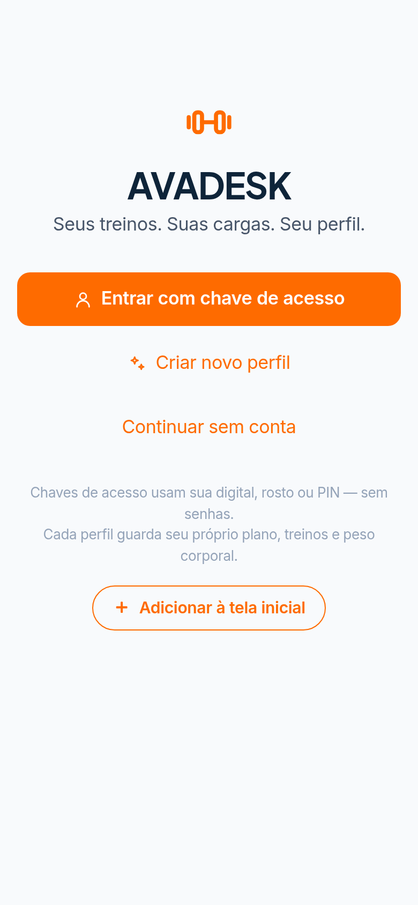

| Elemento | O que faz | Para onde vão os dados |
|---|---|---|
| **Entrar com passkey** | Abre o diálogo biométrico do sistema (Face ID/digital/PIN). | `POST /api/login/options` → `navigator.credentials.get` → `POST /api/login/verify` (cria cookie de sessão) → `GET /api/data` baixa o estado |
| **Criar novo perfil** | Abre sheet “Crie seu perfil” (nome + código de convite se `invite_only`). | `GET /api/config`; `POST /api/register/options` → `credentials.create` → `POST /api/register/verify`. Se já havia dados locais, faz `PUT /api/data` (migra o aparelho para a conta) |
| **Continuar sem conta** | Entra como convidado. | `localStorage.gym_guest = '1'`; nada vai ao servidor |
| Botão **Instalar** (InstallButton) | Instala o PWA na tela inicial (quando suportado). | — |

Sheet “Criar perfil”:
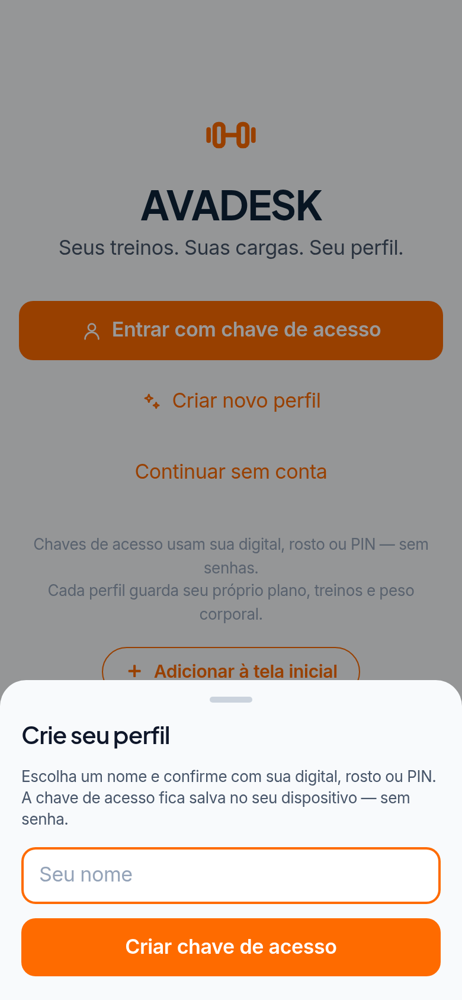

> Se o navegador não suporta passkeys, só aparece “Continuar sem conta” e um aviso.

### 3.2 Início (`views/Home.jsx`)
Vazio (primeiro uso) e com plano carregado:

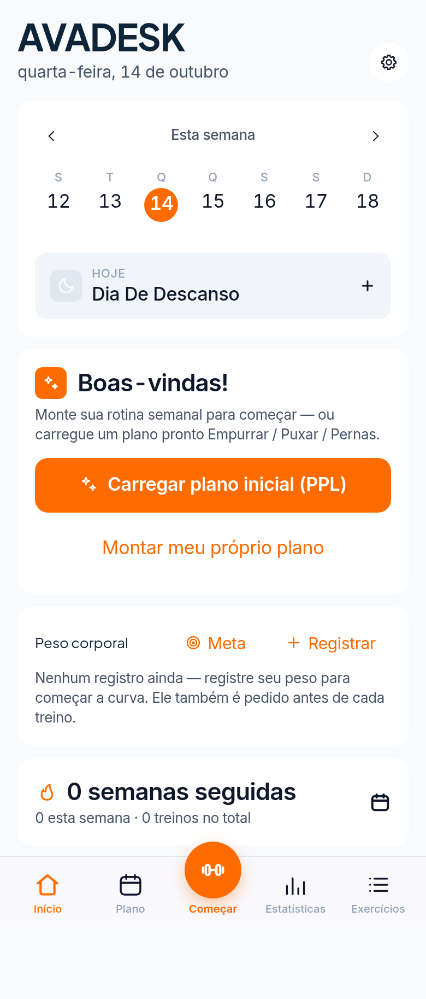 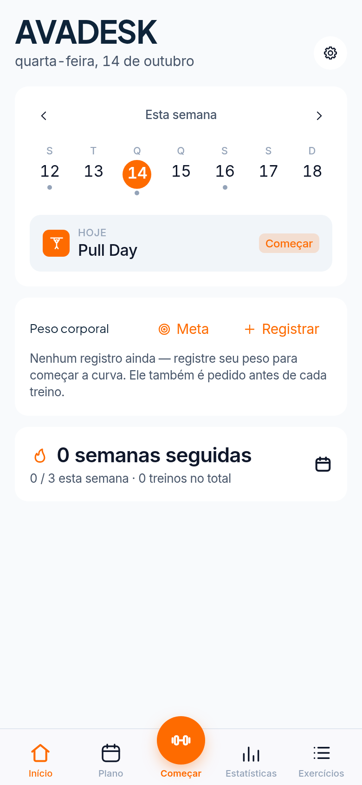

| Elemento | O que faz | Dados |
|---|---|---|
| Título “Olá {nome}” / data | Saudação | `user.name` |
| ⚙ (canto sup. direito) | Abre Configurações `#/settings` | — |
| ‹ › Semana | Navega semanas anteriores/próximas | local |
| Faixa de 7 dias (ponto cinza = planejado, laranja = remarcado, verde = feito) | Toque num dia abre sheet para **trocar/remarcar o treino daquele dia** ou marcar descanso | `S.dayPlan[data]` |
| Cartão **Hoje · {rotina} · Começar/Retomar** | Inicia o treino do dia (abre check-in de peso) ou retoma o ativo; se descanso, abre a sheet do dia | `S.active` |
| Card **Bem-vindo!** (só sem rotinas) → **Carregar plano inicial (PPL)** | Cria 3 rotinas prontas Empurrar/Puxar/Pernas e distribui na semana | `S.routines`, `S.week` |
| → **Montar meu próprio plano** | Vai para `#/plan` | — |
| **Peso corporal · Meta** | Sheet para definir peso-alvo | `S.targetW` |
| **Peso corporal · + Registrar** | Sheet de peso (± / slider) | `S.bodyweight[]` |
| Gráfico de peso (últimos 30) | Visualização | — |
| **N semanas seguidas** + ícone calendário | Sequência semanal; ícone leva ao histórico/estatísticas | `S.workouts` |

Sheet do dia (remarcar):
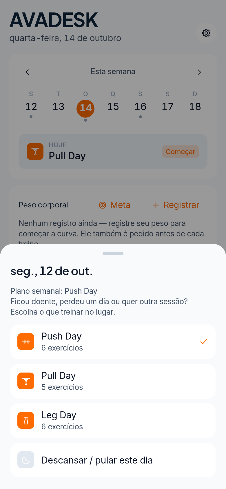

Resultado de “Carregar plano inicial”:
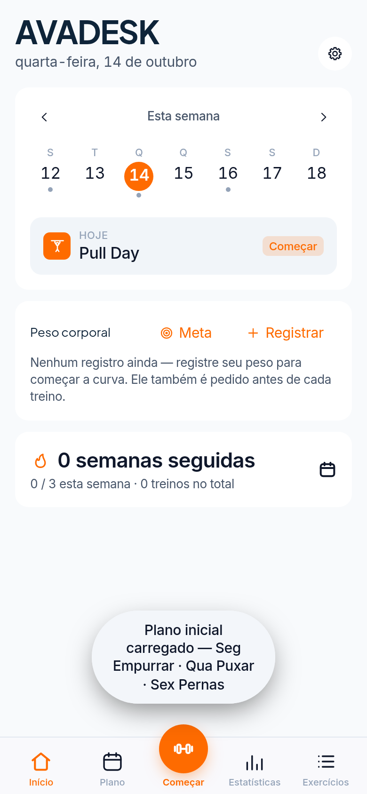

### 3.3 Plano (`views/Plan.jsx`)
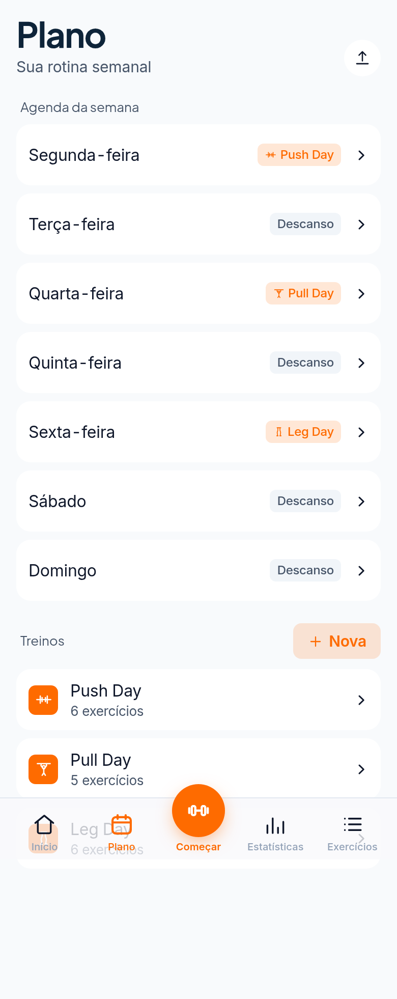

| Elemento | O que faz | Dados |
|---|---|---|
| Ícone **Compartilhar plano** | Gera link/código do plano (`lib/plan-share.js`) para outra pessoa importar | codificado na URL, sem servidor |
| Semana Seg–Dom | Toque num dia escolhe qual rotina cai nele | `S.week` |
| Lista de rotinas | Toque abre o editor `#/plan/r/:id` | — |
| **+ Novo** | Cria rotina vazia e abre o editor | `S.routines.push` |
| **Carregar plano inicial (Empurrar/Puxar/Pernas)** | Igual ao da Home | `S.routines`, `S.week` |

### 3.4 Editar rotina (`views/RoutineEdit.jsx`)
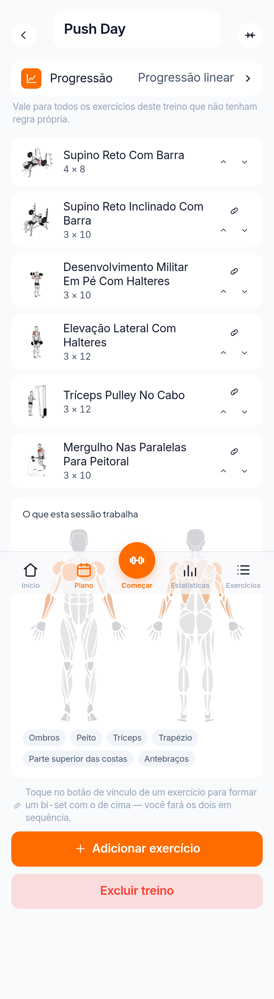

| Elemento | O que faz | Dados |
|---|---|---|
| ‹ voltar | Volta a `#/plan` | — |
| Campo nome | Renomeia a rotina (salva ao digitar) | `routine.name` |
| Ícone | Seletor de ícone (glyphPicker) | `routine.emoji` |
| **Progressão** | Escolhe regra (linear, dupla progressão etc. — `lib/progression.js`) | `routine.prog` |
| Item de exercício (toque) | Abre sheet de configuração (séries, reps, carga, descanso, progressão própria, remover) | `routine.ex[i]` |
| 🔗 | Liga com o exercício de cima (**superset**) | `ex.sg` |
| ▲ ▼ | Reordena | ordem do array |
| “O que esta sessão trabalha” | Mapa corporal 2D (BodyMap) com músculos atingidos | calculado (`lib/muscles.js`) |
| **+ Adicionar exercício** | Abre seletor de exercícios → sheet de configuração | `routine.ex.push` |
| **Excluir rotina** | Confirmação; remove e limpa semana/remarcações | `S.routines`, `S.week`, `S.dayPlan` |

Configurar exercício e seletor:

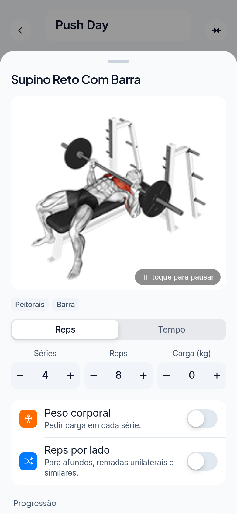 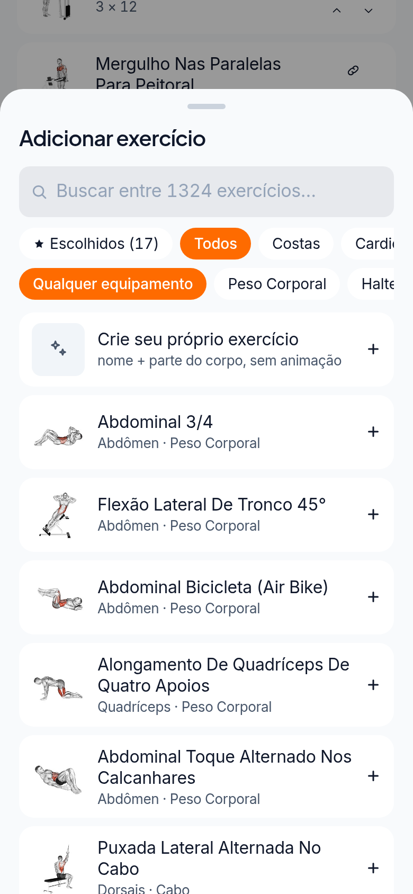

### 3.5 Começar treino (botão central da barra) e Check-in
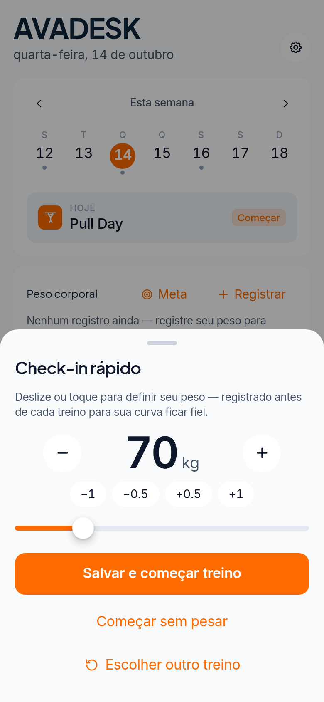 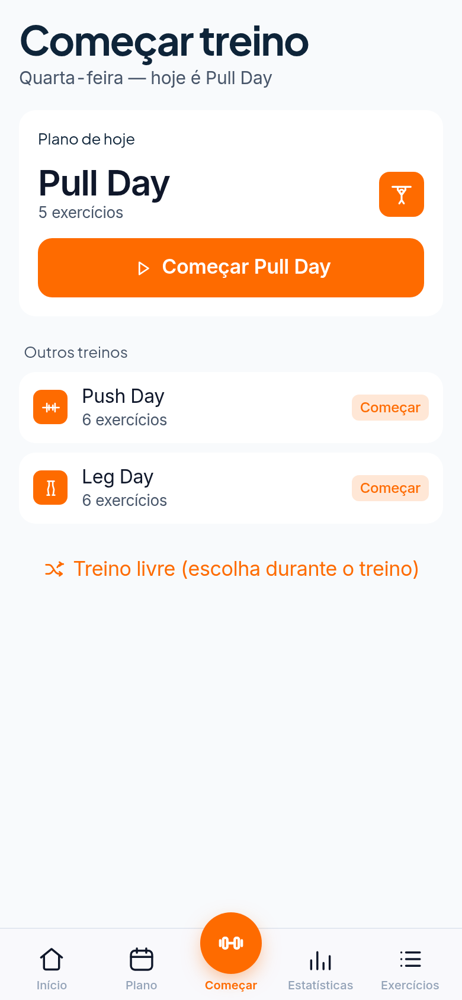

| Elemento | O que faz | Dados |
|---|---|---|
| Botão central **Começar** | Se há rotina hoje, abre o **Check-in rápido**; se não, abre a tela “Começar treino” | — |
| − / + / −1 −0.5 +0.5 +1 / slider | Ajusta peso corporal | — |
| **Salvar e começar treino** | Registra peso e inicia | `S.bodyweight`, `S.active` |
| **Começar sem pesar** | Inicia sem registrar peso | `S.active` |
| **Escolher outro treino** | Lista de rotinas + “Treino livre” | — |

Sem plano montado, “Começar” leva a esta tela (só treino livre):
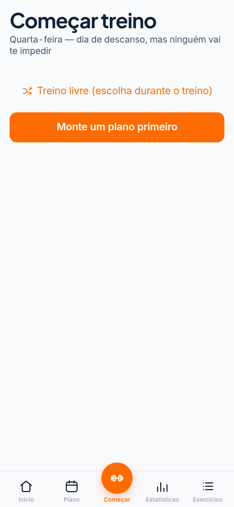

### 3.6 Treino em execução (`views/Workout.jsx`)
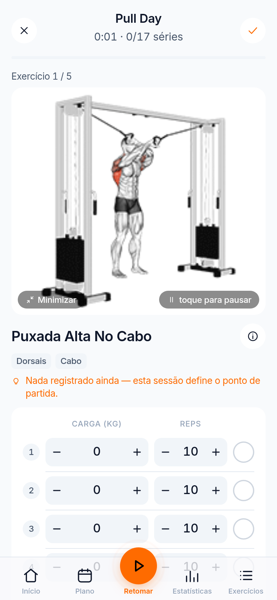

Tela inteira (rolagem): [17b-treino-em-execucao-completo.png](wireframes/17b-treino-em-execucao-completo.png)

| Elemento | O que faz | Dados |
|---|---|---|
| ✕ **Descartar** | Cancela o treino (confirmação) | `S.active = null` |
| ✓ **Finalizar** | Encerra; se nada marcado, pergunta “Finalizar mesmo assim” | `S.workouts.push`, `S.exWeights`; `POST /api/activity` (logado) |
| Cabeçalho “0:01 · 0/17 séries” | Cronômetro e progresso | — |
| “Exercício 1/5” + GIF | Animação; **Minimizar** reduz GIF; **toque para pausar** | `S.gifSize` |
| ⓘ **Detalhes** | Sheet com instruções/músculos | `instr/pt.js` |
| Linhas de série: − carga +, − reps + | Ajusta carga e repetições | `S.active` |
| ◯ (círculo) **Iniciar/concluir série** | Marca a série e dispara o **timer de descanso** (RestTimer, som, push opcional) | `POST /api/push/rest-timer` (logado com push) |
| RIR/RPE (se ativado) | Esforço por série | `effort` |
| **+ Adicionar série / − Remover série** | Altera número de séries | `S.active` |
| Barra inferior “Retomar” | Indica treino ativo | — |

Detalhes do exercício durante o treino: [18b-detalhes-exercicio-treino.png](wireframes/18b-detalhes-exercicio-treino.png)

Finalizar sem séries:
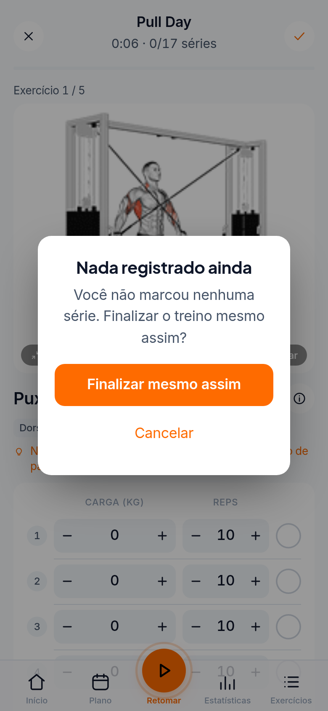

### 3.7 Estatísticas (`views/Stats.jsx`) e Histórico (`views/History.jsx`)
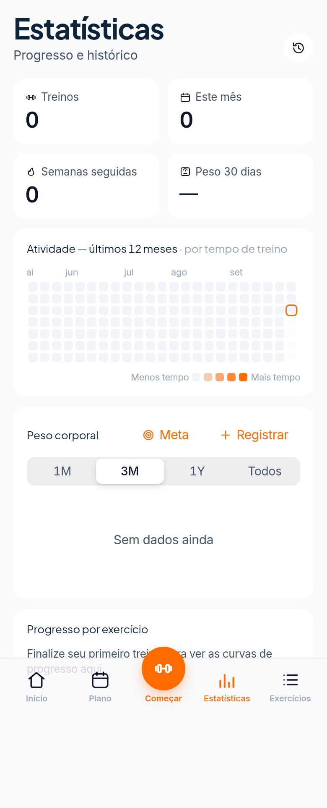 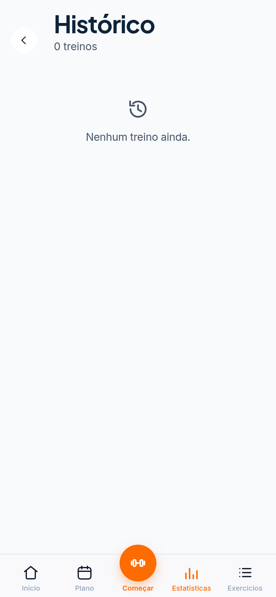

| Elemento | O que faz |
|---|---|
| Ícone **Histórico** | Abre `#/history` (lista de treinos; toque abre detalhe/editar/excluir) |
| Peso corporal | Gráfico de linha |
| Equilíbrio muscular | Mapa corporal com volume por músculo |
| Atividade — últimos 12 meses | Heatmap de dias treinados |
| Esforço | Distribuição RIR/RPE |
| Progresso por exercício | Escolhe exercício → gráfico de 1RM estimado (`lib/onerm.js`) |

Todos lidos de `S.workouts`/`S.bodyweight` (nada novo no servidor).

### 3.8 Exercícios / Biblioteca (`views/Library.jsx`)
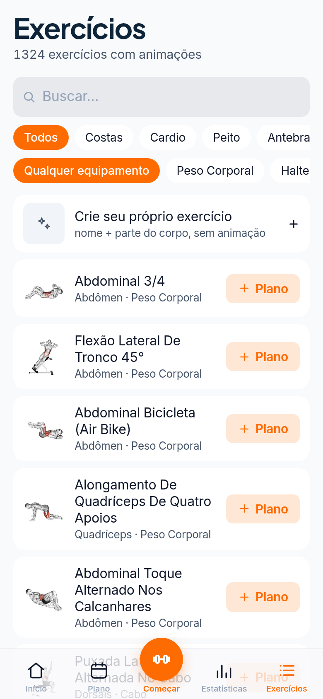

| Elemento | O que faz | Dados |
|---|---|---|
| Busca | Por nome, músculo, equipamento, descrição | catálogo local |
| Chips de parte do corpo / equipamento | Filtros | — |
| **Crie seu próprio exercício** | Sheet nome + parte do corpo | `S.customEx` |
| Item | Abre detalhe (GIF, instruções, recorde) | — |
| **+ Plano** | Adiciona o exercício a uma rotina | `routine.ex` |
| **Mostrar mais** | Paginação de 40 em 40 | — |

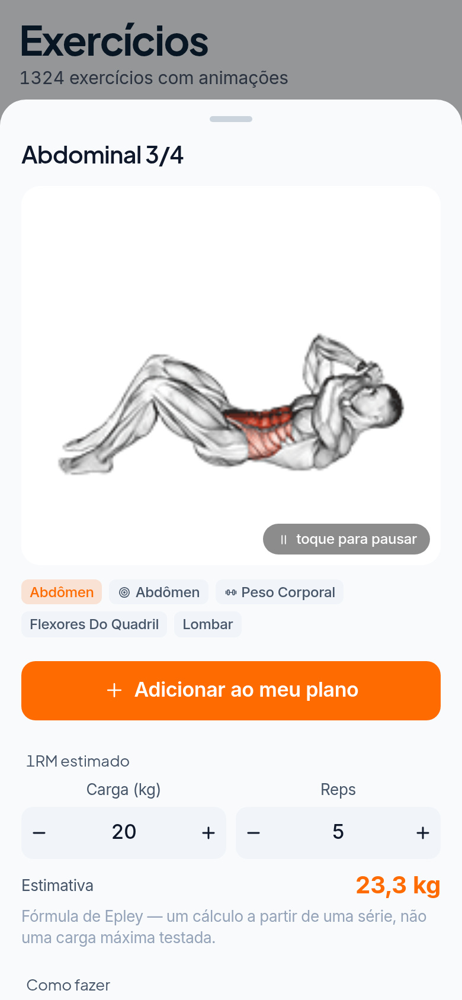 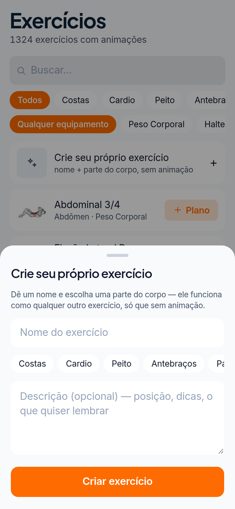

### 3.9 Configurações (`views/Settings.jsx`)
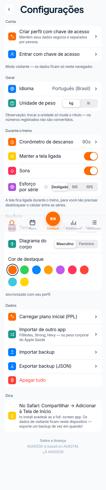

| Seção | Itens | Dados |
|---|---|---|
| Conta (convidado) | “Todos os dados ficam neste celular”; **Criar perfil com passkey**; **Entrar com passkey** | ver Login |
| Conta (logado) *(do código)* | Nome; **Sair** (`POST /api/logout`, antes faz `PUT /api/data`); **Sair de todos os aparelhos** (`POST /api/logout/all`); **Painel admin** (se admin) | cookie / db.json |
| Geral | Idioma, unidade (kg/lb), diagrama corporal (masc/fem) | `S.lang/unit/body` |
| Aparência | Tema claro/escuro, cor de destaque | `S.theme/accent` |
| Durante o treino | Timer de descanso, sons, manter tela acesa, esforço por série (RIR/RPE) | `S.restSec/sound/keepAwake/effort` |
| Notificações *(logado)* | Push: `GET /api/push/public-key`, `POST /api/push/subscribe`/`unsubscribe`, **Enviar notificação de teste** (`POST /api/push/test`), lembrete de dia de treino + horário | `S.reminder`, db.json |
| Dados | **Exportar backup (JSON)**, **Importar backup**, **Importar de outro app** (FitNotes, Strong, Hevy, Apple Health — `lib/import-csv.js`), **Carregar plano inicial**, **Resetar tudo** | arquivo local / `S` |
| Rodapé | Créditos openGym / Self-host | — |

### 3.10 Admin (`views/Admin.jsx`) — *não capturável (exige login admin)*
Acessar `#/admin` sem ser admin redireciona para Início ([20-admin-redireciona.png](wireframes/20-admin-redireciona.png)).

```
┌──────────────────────────────┐
│ ‹  Admin                  ⟳  │
├──────────────────────────────┤
│ Usuários (N)                 │
│ ┌──────────────────────────┐ │
│ │ Nome · último acesso  🔔 │ │ ← toque: detalhes (GET /api/admin/user?id=)
│ │ treinos · passkeys       │ │    [Desativar] POST /api/admin/user/disable
│ └──────────────────────────┘ │
├──────────────────────────────┤
│ Códigos de convite  [+ Gerar]│ ← POST /api/admin/invites/new
│ ABCD1234   usado/livre   ✕   │ ← POST /api/admin/invites/revoke
└──────────────────────────────┘
```
Lista vem de `GET /api/admin/users` e `GET /api/admin/invites`.

---

## 4. Endpoints da API e armazenamento [HOJE]

| Método e rota | Função | Armazena em |
|---|---|---|
| `GET /api/health` | status + nº usuários | — |
| `GET /api/config` | `invite_only` | env |
| `GET /api/me` | usuário da sessão | db.json |
| `POST /api/register/options` · `/verify` | cadastro passkey (WebAuthn) | db.json (users, credentials, invites) |
| `POST /api/login/options` · `/verify` | login passkey | cookie assinado (`secret`) |
| `POST /api/logout` · `/logout/all` | encerra sessão / todas | db.json (versão de sessão) |
| `GET /api/data` · `PUT /api/data` | baixa/salva o **estado inteiro** | `state-<uid>.json` |
| `GET /api/push/public-key`, `POST /api/push/subscribe`, `/unsubscribe`, `/test`, `/rest-timer`, `/rest-timer/cancel` | Web Push (descanso, lembretes) | db.json, vapid.json |
| `POST /api/activity` | registra atividade (último treino) para admin | db.json |
| `GET /api/admin/users`, `GET /api/admin/user`, `POST /api/admin/user/disable`, `GET /api/admin/invites`, `POST /api/admin/invites/new`, `/revoke` | painel admin | db.json |

**Limitações:** não há papéis além de `admin`; não há vínculo profissional↔aluno; não há catálogo de programas no servidor; o histórico é um blob JSON por usuário (não consultável).

---

## 5. Problemas de usabilidade no celular

1. **Primeiro uso sem direção**: o aluno cai na Home com “Carregar PPL” ou “Montar meu plano” — não pergunta objetivo, nível, restrição.
2. **Criar treino exige muitos passos**: Plano → Novo → nomear → Adicionar exercício → buscar em ~1.300 exercícios → sheet de séries/reps → repetir → voltar → atribuir dia.
3. **Vocabulário técnico**: “Progressão linear”, “superset”, RIR/RPE, 1RM aparecem para iniciantes.
4. **Execução densa**: GIF grande + tabela de séries com 4 botões pequenos (−/+) por linha; o botão de concluir série é um círculo pequeno no canto direito.
5. **Botão “Começar” abre check-in de peso** antes de treinar (fricção diária).
6. **Sem área do profissional**: personal/fisioterapeuta não consegue prescrever para alunos.
7. **Sem restrições de saúde**: nada impede sugerir agachamento a quem tem dor no joelho.

---

## 6. Proposta de nova experiência [PROPOSTO]

Princípios: **1 decisão por tela**, botões ≥ 56 px na zona do polegar, linguagem simples (“Fácil / Bom / Pesado” no lugar de RIR), programa pronto como padrão e criação manual como opção avançada.

### 6.0 Novo mapa de navegação
```
Onboarding (1ª vez) ─► Hoje ──► [Começar treino] ─► Execução ─► Resumo
                         │
Barra inferior:  [Hoje]  [Biblioteca]  [ ▶ Treinar ]  [Progresso]  [Perfil]
                                              (Profissional aparece no Perfil se papel = pro)
```

### 6.1 Onboarding por objetivo (4 passos, ~30 s)
```
┌──────────────────────────────┐   ┌──────────────────────────────┐
│ ●○○○                Pular    │   │ ●●○○                ‹ Voltar │
│                              │   │                              │
│  Qual é o seu objetivo?      │   │  Qual sua experiência?       │
│                              │   │                              │
│ ┌──────────────────────────┐ │   │ ┌──────────────────────────┐ │
│ │ 💪 Ganhar massa muscular │ │   │ │ 🌱 Nunca treinei         │ │
│ └──────────────────────────┘ │   │ └──────────────────────────┘ │
│ ┌──────────────────────────┐ │   │ ┌──────────────────────────┐ │
│ │ 🔥 Emagrecer             │ │   │ │ 🙂 Treino às vezes       │ │
│ └──────────────────────────┘ │   │ └──────────────────────────┘ │
│ ┌──────────────────────────┐ │   │ ┌──────────────────────────┐ │
│ │ 🩺 Reabilitação / dor    │ │   │ │ 🏋 Treino há +1 ano      │ │
│ └──────────────────────────┘ │   │ └──────────────────────────┘ │
│ ┌──────────────────────────┐ │   │                              │
│ │ 🧘 Mobilidade / saúde    │ │   │                              │
│ └──────────────────────────┘ │   │                              │
└──────────────────────────────┘   └──────────────────────────────┘
┌──────────────────────────────┐   ┌──────────────────────────────┐
│ ●●●○                         │   │ ●●●●                         │
│  Onde e quantos dias?        │   │  Alguma dor ou restrição?    │
│                              │   │  [ ] Lombar   [ ] Joelho     │
│  ( Academia ) ( Casa )       │   │  [ ] Ombro    [ ] Gestante   │
│  ( Casa sem equipamento )    │   │  [ ] Hipertensão [ ] Nenhuma │
│                              │   │                              │
│  Dias/semana:  2  3 [4] 5 6  │   │  ⓘ Não substitui avaliação   │
│  Tempo: 30 [45] 60 min       │   │    médica.                   │
│                              │   │                              │
│ ┌──────────────────────────┐ │   │ ┌──────────────────────────┐ │
│ │        Continuar         │ │   │ │  Ver programas sugeridos │ │
│ └──────────────────────────┘ │   │ └──────────────────────────┘ │
└──────────────────────────────┘   └──────────────────────────────┘
```
Dados: `user_profiles` (objetivo, nível, local, dias, tempo) + `health_restrictions` → filtra `programs`.

### 6.2 Programas sugeridos / Biblioteca de Treinos
```
┌──────────────────────────────┐
│ Biblioteca de Treinos     🔍 │
│ (Todos)(Hipertrofia)(Emagrec)│
│ (Iniciante)(Fisio)(Mobil)(Casa)│
├──────────────────────────────┤
│ ⭐ Recomendado para você      │
│ ┌──────────────────────────┐ │
│ │ [img] Massa Magra A/B/C  │ │
│ │ 4x/sem · 50 min · Interm.│ │
│ │ Peito·Costas·Pernas      │ │
│ │          [ Selecionar ]  │ │
│ └──────────────────────────┘ │
│ ┌──────────────────────────┐ │
│ │ [img] Iniciante Total    │ │
│ │ 3x/sem · 35 min · Inic.  │ │
│ └──────────────────────────┘ │
│ ┌──────────────────────────┐ │
│ │ 🩺 Lombar sem dor (fisio)│ │
│ │ 3x/sem · 20 min · leve   │ │
│ └──────────────────────────┘ │
│ ... Emagrecimento HIIT, Joelho│
│ forte, Ombro saudável,        │
│ Mobilidade diária, Em casa    │
│ sem equipamento               │
└──────────────────────────────┘
```
Catálogo inicial sugerido:

| Programa | Público | Freq. | Estrutura |
|---|---|---|---|
| Massa Magra / Hipertrofia ABC | intermediário | 3–6x | A peito/tríceps, B costas/bíceps, C pernas/ombros |
| Hipertrofia Full Body | iniciante/inter. | 3x | corpo todo |
| Emagrecimento (circuito + cardio) | todos | 3–5x | circuitos 40 s/20 s |
| Iniciante Total (8 semanas) | iniciante | 3x | máquinas guiadas, progressão simples |
| Fisio — Lombar | dor lombar | 3x | core, glúteo, mobilidade quadril |
| Fisio — Joelho | dor/pós-lesão | 3x | isometria, cadeia posterior, sem impacto |
| Fisio — Ombro | dor/pós-lesão | 3x | manguito, escápula, elástico |
| Mobilidade diária | todos | 5–7x | 10–15 min |
| Em casa sem equipamento | todos | 3–4x | peso corporal |

Detalhe do programa:
```
┌──────────────────────────────┐
│ ‹  Massa Magra ABC           │
│ [ imagem / boneco 3D com     │
│   músculos do programa ]     │
│ 4x/sem · 8 semanas · 50 min  │
│ Por: Equipe AVAGYM / Prof. X │
├──────────────────────────────┤
│ Treino A — Peito e tríceps ›│
│ Treino B — Costas e bíceps  ›│
│ Treino C — Pernas           ›│
├──────────────────────────────┤
│ Dias: [S] T [Q] Q [S] S  D   │
│ ┌──────────────────────────┐ │
│ │   Começar este programa  │ │ → cria user_programs
│ └──────────────────────────┘ │
└──────────────────────────────┘
```

### 6.3 Hoje (nova Home)
```
┌──────────────────────────────┐
│ Olá, Ana            🔔  👤   │
│ Semana 2 de 8 · Massa Magra  │
│ S  T  Q  Q  S  S  D          │
│ ✓  ·  ●  ·  ○  ·  ·          │
├──────────────────────────────┤
│ HOJE                         │
│ Treino B — Costas e bíceps   │
│ 6 exercícios · ~45 min       │
│ [mini boneco 3D destacado]   │
│ ┌──────────────────────────┐ │
│ │    ▶  COMEÇAR TREINO     │ │  ← 1 toque, sem check-in obrigatório
│ └──────────────────────────┘ │
│  Trocar treino · Hoje descanso│
├──────────────────────────────┤
│ 🔥 3 semanas seguidas         │
│ ⚖ 72,4 kg  [+ registrar]     │
└──────────────────────────────┘
```

### 6.4 Execução “Começar treino” (botões grandes)
```
┌──────────────────────────────┐
│ ✕          12:31         ⏸   │
│ ▓▓▓▓▓░░░░░  Exercício 2 de 6 │
├──────────────────────────────┤
│   [ GIF / 3D do exercício ]  │
│                              │
│ Remada baixa         ⓘ Como  │
│ Série 2 de 3 · meta 10–12    │
├──────────────────────────────┤
│   CARGA            REPS      │
│ ┌────┐ 40kg ┌────┐ ┌──┐12┌──┐│
│ │ −  │      │ +  │ │− │  │+ ││  ← botões 64px
│ └────┘      └────┘ └──┘  └──┘│
│ Como foi?  (Fácil)(Bom)(Pesado)│
│ ┌──────────────────────────┐ │
│ │      ✓  FEITO            │ │  ← 72px, largura total
│ └──────────────────────────┘ │
│  Pular série · Trocar exerc.  │
└──────────────────────────────┘

Após "FEITO" (descanso em tela cheia):
┌──────────────────────────────┐
│         DESCANSO             │
│           1:15               │
│   ( −15s )      ( +15s )     │
│ Próximo: Série 3 · 40 kg × 12│
│ ┌──────────────────────────┐ │
│ │        PULAR DESCANSO    │ │
│ └──────────────────────────┘ │
└──────────────────────────────┘

Fim:
┌──────────────────────────────┐
│ 🎉 Treino concluído!          │
│ 46 min · 18 séries · 5.420 kg│
│ 2 recordes 🏆                 │
│ Como se sentiu? 😫 😐 🙂 💪   │
│ Dor? [ ] Lombar [ ] Joelho…  │ → session_feedback (alerta pro)
│ ┌──────────────────────────┐ │
│ │       Salvar e sair      │ │
│ └──────────────────────────┘ │
└──────────────────────────────┘
```
Carga sugerida = última carga + regra de progressão (lógica de `lib/progression.js` reaproveitada, mas oculta).

### 6.5 Criador de treino simples (template + seletor 3D)
```
Passo 1                              Passo 2 — músculos (3D, teste-corpo-3d)
┌──────────────────────────────┐     ┌──────────────────────────────┐
│ ‹ Novo treino                │     │ ‹ Toque nos músculos         │
│ Comece de:                   │     │   [ boneco 3D girável ]      │
│ ( Do zero )                  │     │   frente ⟲ costas            │
│ ( Copiar programa da Bibliot)│     │   peitoral ● dorsal ●        │
│ ( Modelo: Superior/Inferior )│     │ Selecionados: Peito, Tríceps │
│ ( Modelo: Corpo todo )       │     │ [ Sugerir exercícios ▸ ]     │
└──────────────────────────────┘     └──────────────────────────────┘
Passo 3 — exercícios sugeridos       Passo 4 — revisar
┌──────────────────────────────┐     ┌──────────────────────────────┐
│ Para Peito (equip.: academia)│     │ Treino A — Peito/Tríceps     │
│ [✓] Supino reto  3×10        │     │ 1 Supino reto     3×10  ≡    │
│ [✓] Crucifixo    3×12        │     │ 2 Crucifixo       3×12  ≡    │
│ [ ] Flexão       3×máx       │     │ 3 Tríceps corda   3×12  ≡    │
│ ⚠ oculto: agach. (joelho)    │     │ Dias: S Q S   Descanso 90s   │
│ [ + buscar outro ]           │     │ ┌──────────────────────────┐ │
│ ┌──────────────────────────┐ │     │ │         Salvar           │ │
│ │       Próximo (3)        │ │     │ └──────────────────────────┘ │
│ └──────────────────────────┘ │     └──────────────────────────────┘
└──────────────────────────────┘
```
Usa `exercise_muscles` (mapeamento do PRD) e `exercise_contraindications` × `health_restrictions`.

### 6.6 Progresso
```
┌──────────────────────────────┐
│ Progresso                    │
│ (Semana)(Mês)(Ano)           │
│ Treinos: 12   Tempo: 9h      │
│ [mapa 3D de calor muscular]  │
│ Peso corporal  ── gráfico ── │
│ Recordes: Supino 60kg ↑      │
│ Histórico ›                  │
└──────────────────────────────┘
```

### 6.7 Perfil
```
┌──────────────────────────────┐
│ 👤 Ana · Aluna               │
│ Objetivo: Massa · Joelho ⚠   │ ›editar onboarding
│ Meu profissional: Prof. João │
│ Preferências (kg, tema, sons)│
│ Backup / Importar            │
│ Sair                         │
│ Créditos: baseado no openGym │
│ (AGPL-3.0)                   │
└──────────────────────────────┘
```

### 6.8 Área do profissional (personal / fisioterapeuta)
```
┌──────────────────────────────┐   ┌──────────────────────────────┐
│ Meus alunos         [+ Conv.]│   │ ‹ Ana Souza                  │
│ 🔍 buscar                     │   │ Massa Magra · sem 2/8        │
│ ┌──────────────────────────┐ │   │ Adesão: 7/8 treinos ▓▓▓▓▓▓░  │
│ │ Ana · treinou hoje ✓     │ │   │ ⚠ Relatou dor no joelho (2d) │
│ │ Bruno · 5 dias sem ⚠     │ │   │ [ Prescrever programa ]      │
│ │ Carla · dor lombar 🩺    │ │   │ [ Editar treino B ]          │
│ └──────────────────────────┘ │   │ [ Mensagem ]                 │
│ Meus programas  ›            │   │ Últimas sessões ›            │
│ (criar programa p/ biblioteca)│   │ Restrições: Joelho (fisio)  │
└──────────────────────────────┘   └──────────────────────────────┘
```
Admin atual (usuários + convites) vira “Admin da academia”: profissionais, alunos, convites, programas publicados.

---

## 7. Esquema de banco de dados Postgres [PROPOSTO]

```sql
-- ===== Usuários e papéis =====
create table users (
  id uuid primary key default gen_random_uuid(),
  name text not null,
  email text unique,
  disabled_at timestamptz,
  created_at timestamptz not null default now(),
  last_seen_at timestamptz
);
create table webauthn_credentials (            -- hoje: db.json
  id text primary key, user_id uuid not null references users on delete cascade,
  public_key bytea not null, counter bigint not null default 0,
  transports text[], created_at timestamptz default now()
);
create type role_kind as enum ('student','professional','gym_admin','super_admin');
create table organizations ( id uuid primary key default gen_random_uuid(), name text not null );
create table memberships (
  user_id uuid references users on delete cascade,
  org_id uuid references organizations on delete cascade,
  role role_kind not null,
  primary key (user_id, org_id, role)
);
create table coach_students (
  coach_id uuid references users, student_id uuid references users,
  org_id uuid references organizations, since timestamptz default now(),
  primary key (coach_id, student_id)
);
create table invites (                          -- hoje: db.json
  code text primary key, org_id uuid references organizations,
  role role_kind default 'student', created_by uuid references users,
  used_by uuid references users, revoked_at timestamptz, created_at timestamptz default now()
);
create table user_profiles (
  user_id uuid primary key references users on delete cascade,
  goal text check (goal in ('hypertrophy','weight_loss','rehab','mobility','general')),
  level text check (level in ('beginner','intermediate','advanced')),
  location text check (location in ('gym','home','home_noequip')),
  days_per_week smallint, minutes_per_session smallint,
  sex text, birth_date date, height_cm numeric(5,1),
  prefs jsonb not null default '{}'               -- unidade, tema, sons, descanso (hoje: S.*)
);
create table health_restrictions (
  id serial primary key, user_id uuid references users on delete cascade,
  code text not null,                -- 'lumbar','knee','shoulder','pregnancy','hypertension'
  severity smallint, notes text, set_by uuid references users, created_at timestamptz default now()
);

-- ===== Exercícios e músculos =====
create table muscles (
  id text primary key,               -- 'pectoralis_major', ids alinhados ao modelo 3D
  name_pt text not null, region text, mesh_ids text[]   -- nós do GLB em teste-corpo-3d
);
create table equipment ( id text primary key, name_pt text not null );
create table exercises (               -- hoje: lib/exercises-data.js + S.customEx
  id text primary key, name_pt text not null, name_en text,
  equipment_id text references equipment, body_part text,
  media_url text, instructions_pt text, level text,
  owner_id uuid references users,      -- null = catálogo global; senão exercício custom
  created_at timestamptz default now()
);
create table exercise_muscles (
  exercise_id text references exercises on delete cascade,
  muscle_id text references muscles,
  role text check (role in ('primary','secondary','stabilizer')),
  weight numeric(3,2) default 1,
  primary key (exercise_id, muscle_id)
);
create table exercise_contraindications (
  exercise_id text references exercises, restriction_code text,
  level text check (level in ('avoid','caution')), note text,
  primary key (exercise_id, restriction_code)
);

-- ===== Biblioteca de programas =====
create table programs (
  id uuid primary key default gen_random_uuid(),
  slug text unique, title text not null, description text,
  goal text, level text, location text, weeks smallint, days_per_week smallint,
  minutes smallint, cover_url text, tags text[],
  author_id uuid references users, org_id uuid references organizations,
  visibility text check (visibility in ('public','org','private')) default 'public',
  is_rehab boolean default false, published_at timestamptz
);
create table program_workouts (           -- Treino A, B, C…
  id uuid primary key default gen_random_uuid(),
  program_id uuid references programs on delete cascade,
  position smallint, name text not null, focus text
);
create table program_workout_exercises (
  id uuid primary key default gen_random_uuid(),
  program_workout_id uuid references program_workouts on delete cascade,
  position smallint, exercise_id text references exercises,
  sets smallint, reps_min smallint, reps_max smallint, duration_sec int,
  rest_sec smallint, superset_group smallint, progression text, notes text
);

-- ===== Treinos do usuário =====
create table user_programs (               -- programa ativo do aluno
  id uuid primary key default gen_random_uuid(),
  user_id uuid references users on delete cascade,
  program_id uuid references programs, prescribed_by uuid references users,
  start_date date, schedule jsonb,          -- {"mon":"<workout_id>",...} (hoje: S.week)
  status text default 'active'
);
create table workouts (                    -- rotinas editáveis (hoje: S.routines)
  id uuid primary key default gen_random_uuid(),
  user_id uuid references users on delete cascade,
  user_program_id uuid references user_programs,
  source_program_workout_id uuid references program_workouts,
  name text not null, icon text, progression text default 'linear',
  created_at timestamptz default now(), updated_at timestamptz default now()
);
create table workout_exercises (
  id uuid primary key default gen_random_uuid(),
  workout_id uuid references workouts on delete cascade,
  position smallint, exercise_id text references exercises,
  sets smallint, reps_min smallint, reps_max smallint, target_weight numeric(6,2),
  rest_sec smallint, superset_group smallint, progression text
);
create table schedule_overrides (          -- hoje: S.dayPlan
  user_id uuid references users, day date, workout_id uuid references workouts,
  primary key (user_id, day)
);

-- ===== Sessões (execução) =====
create table sessions (                    -- hoje: S.workouts[] / S.active
  id uuid primary key default gen_random_uuid(),
  user_id uuid references users on delete cascade,
  workout_id uuid references workouts, started_at timestamptz not null,
  finished_at timestamptz, status text default 'in_progress',
  feeling smallint, notes text
);
create table session_sets (
  id bigserial primary key,
  session_id uuid references sessions on delete cascade,
  exercise_id text references exercises, set_index smallint,
  weight numeric(6,2), reps smallint, duration_sec int,
  effort text,                   -- 'easy'|'good'|'hard' ou rir/rpe
  done_at timestamptz
);
create table session_pain_reports (
  session_id uuid references sessions on delete cascade,
  restriction_code text, intensity smallint, primary key (session_id, restriction_code)
);

-- ===== Peso corporal =====
create table body_weights (                -- hoje: S.bodyweight / S.targetW
  id bigserial primary key, user_id uuid references users on delete cascade,
  measured_at timestamptz not null, weight_kg numeric(5,2) not null, source text
);
create table body_goals ( user_id uuid primary key references users, target_kg numeric(5,2) );

-- ===== Push =====
create table push_subscriptions (          -- hoje: db.json
  id bigserial primary key, user_id uuid references users on delete cascade,
  endpoint text unique, keys jsonb, created_at timestamptz default now()
);

create index on sessions (user_id, started_at desc);
create index on session_sets (exercise_id);
create index on body_weights (user_id, measured_at desc);
create index on programs (goal, level, location);
```

Migração sugerida: script lê `db.json` + `state-*.json` e popula `users`, `webauthn_credentials`, `invites`, `workouts`/`workout_exercises` (de `routines`), `sessions`/`session_sets` (de `workouts`), `body_weights`. O app pode manter o modo convidado offline (localStorage) e sincronizar por endpoints REST novos (`/api/v2/programs`, `/api/v2/sessions` …) em vez do blob `PUT /api/data`.

---

## 8. Hoje x Proposto: resumo

| Área | HOJE | PROPOSTO |
|---|---|---|
| Entrada | Login passkey / convidado; Home com “Carregar PPL” | Onboarding de 4 passos por objetivo, nível, local, restrições |
| Programas | Só 1 plano pronto (PPL) + compartilhar por link | Biblioteca de Treinos filtrável (Hipertrofia, Emagrecimento, Iniciante, Fisio lombar/joelho/ombro, Mobilidade, Casa) |
| Criar treino | Plano → rotina → buscar exercício → configurar (muitos passos) | Modelo + seletor 3D de músculos + sugestões filtradas |
| Execução | Tabela densa, botões pequenos, check-in de peso antes | 1 toque “Começar treino”, botão FEITO gigante, descanso em tela cheia, esforço Fácil/Bom/Pesado |
| Músculos | Mapa 2D (BodyMap) | Modelo 3D (protótipo `teste-corpo-3d`) com `muscles.mesh_ids` |
| Saúde | Nenhuma | Restrições + contraindicações + relato de dor pós-treino |
| Profissional | Só admin (usuários/convites) | Área do profissional: alunos, prescrição, adesão, alertas |
| Dados | JSON (db.json + state-uid.json, blob inteiro) | Postgres normalizado (seção 7) |
