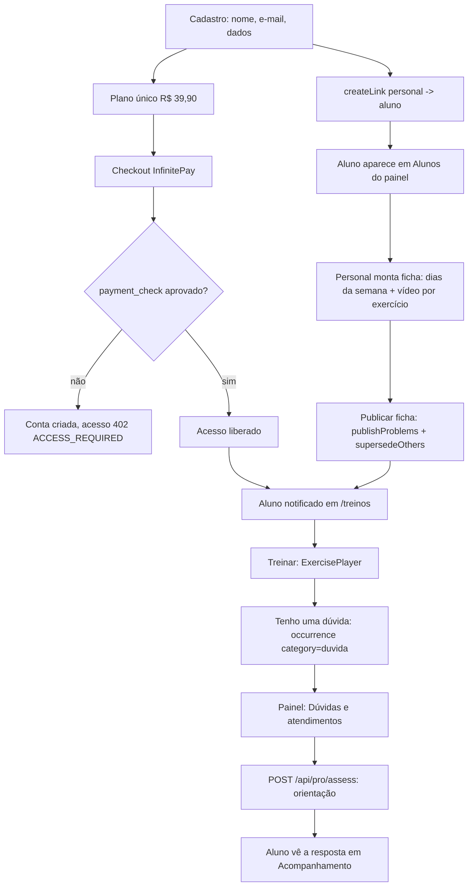

# Anexo técnico — ORNY como app do personal (plano único + painel do personal)

Apoio à implementação. Não exige revisão do usuário. Plano principal entregue no chat.
Data: 20/10/2026. Base: commit `ad3de3a` (cópia independente, sem publicação em VPS).

Decisões do usuário já registradas:

1. Um personal agora, estrutura preservada para vários depois.
2. Plano único R$ 39,90, cobrado no app, mensal, acesso só com pagamento confirmado.
3. Vídeo por link (YouTube/Instagram). Upload direto existente permanece como alternativa.
4. Não há usuários reais nesta base: planos antigos podem sair sem migração de assinantes.

---

## 1. Evidência

### Arquivos lidos e o que confirmaram

| Caminho | Confirmou |
|---|---|
| `app/DOCUMENTACAO-SISTEMA.md` | Fonte oficial. Frontend 1.9.1 / API 1.9.0. Bloqueio comercial exige assinatura paga confirmada (`api/access.js`, HTTP 402 `ACCESS_REQUIRED`). Admin é isento. Provider ativo: InfinitePay, checkout hospedado com cartão e Pix. |
| `api/db/migrations/049_tres_planos.sql` | Catálogo atual nasceu com `aluno_free`, `profissional_free`, `individual`, `pro`. Planos fora do catálogo ficam `active=false, sellable=false` — padrão a reusar. |
| `api/db/migrations/060_precos_oficiais_beta.sql` | `individual` = 1290. Preços são definidos por migration com `price_status='definido'`. |
| `api/db/migrations/063_planos_personal.sql` | `pro` = "Personal 15" 3990 (15 alunos); `pro_ilimitado` = 7990 (limite nulo). Limites vivem em `plan_versions.limits.alunos_ativos`. |
| `api/billing/routes.js` | `CATALOG = ['aluno_free','profissional_free','individual','pro','pro_ilimitado']` (linha 41) governa `GET /api/public/plans` e `GET /api/plans`. `purchasable = !is_free && sellable && price_cents != null`. |
| `api/billing/core.js` | `subscribe` valida `user.roles.includes(plan.audience)` (linha 416) → plano de aluno exige papel `aluno`. `openSub`/`changePlan`/`applyChargeResult` por audiência. |
| `api/entitlements.js` | `ensureSubscription` cai em `FREE_PLAN[audience]` (linha 23) → **`aluno_free` não pode ser apagado**. `METRICS.alunos_ativos` (linha 13) conta `coach_students` do coach e é audiência `profissional`. `checkLimitLocked` exige assinatura `profissional` ativa. |
| `api/auth.js` | `register` valida `plans where id=$1 and audience=$2 and active and sellable and price_cents is not null and not is_free` (linha 142); cria papel `aluno` (154) e adiciona `profissional` quando `intent='profissional'` (157). `contextOf` (92) e `pub` (95) derivam o shell do usuário. `own_student_access` / `coach_has_access` (51–56) decidem origem paga. |
| `api/pro.js` | `guard(role)` aceita admin. `linkFailures` (86) exige: conta do aluno ativa, `professional_profiles.state='ativo'` do coach, vaga em `capacitySummary`, `access_plans.max_professionals` do aluno. `createLink` (107) roda `checkLimitLocked(coachId,'alunos_ativos')` na transação. `POST /api/pro/plans` exige `isLinked`. `CATS` inclui `duvida`. `POST /api/occurrences` (169) bloqueia exercício só para `dor`/`desconforto` (185). `defaultResponsible` (124) usa o vínculo ativo; sem vínculo, `notifyAdmins`. `supersedeOthers` arquiva a ficha anterior. |
| `api/portal.js` | `proOnly = role('profissional')` aceita admin (18–22). `publishProblems` (44) exige perfil profissional ativo + vínculo + título + objetivo. `POST /api/pro/prescriptions` (160) exige `isLinked`; grava `days` + `exercises` achatados, `format_version=2`. `POST /api/adm/capacity` escreve `professional_profiles.capacity` (ignorado por decisão V4 F5). |
| `api/workout-schema.js` | `normDays` já aceita **`weekday` 0–6 ou null** (33) e **`video_url` por exercício** (26); validação exige vídeo `https://` ou `/api/media?` (56). Nada novo é necessário no formato de dados. |
| `api/exmedia.js` | Mídia por exercício já existe: `POST /api/adm/exercises/media` (link https) e `POST /api/adm/exercises/upload` (binário, vídeo ≤ 60 MB, foto ≤ 5 MB, sniff de assinatura, `UPLOADS_DIR`). Leitura liberada a qualquer usuário via `GET /api/exercises/media`. |
| `api/community.js` | `canPublish` (29) já libera admin sem exigir perfil profissional. Limite diário de posts não se aplica a admin (120). |
| `frontend/src/App.jsx` | Três shells por papel: admin (124–142), profissional (144–163), aluno (165–210). `GuidedTabBar` escondida no admin (215). Rota `/pro/treino` abre `Builder` para admin. |
| `frontend/src/views/Login.jsx` | Cadastro em 5 etapas. Etapa 1 = escolha `aluno` / `profissional` (194–199). Etapa 3 filtra `SELLABLE.includes(p.id) && p.audience === intent` (222). Código do personal opcional (207–208). |
| `frontend/src/views/billing/PlansShowcase.jsx` | `SELLABLE = ['individual','pro','pro_ilimitado']` (9) define o que aparece; `PlansShowcase.test.jsx` afirma esse array. |
| `frontend/src/views/admin/AdminApp.jsx` | `NAV` (348–357): 9 grupos, 20 seções, inclusive Profissionais e verificação, Vínculos e convites, Limites de acompanhamento, Solicitações de vagas. `TITLE` derivado de `NAV`. `OLD_TABS` redireciona abas antigas. |
| `frontend/src/views/builder/WorkoutBuilder.jsx` | Construtor atual (admin e profissional). `newEx` (16) já tem `video_url: ''`, mas **não há campo na tela**. Dias têm nome, **sem `weekday`**. Carrega alunos por `C.users` (admin) ou `P.students` (pro). |
| `frontend/src/views/pro/Builder.jsx` | Construtor antigo tem o seletor de dia da semana a reusar (linha 94: `<select>` Livre + `WEEKDAYS`), e `body()` normaliza `weekday: '' → null` (48). |
| `frontend/src/views/guided/Train.jsx` | Execução mostra `img/gif` de `mediaOf` (141, 188–193) e `ExtraMedia` (264–269) num carrossel lateral; vídeo direto usa `<video controls>` sem velocidade; YouTube/Vimeo abre fora do app. Botão "Relatar dor ou problema" (239) abre a folha `report` no fim da tela. Bloqueio por dor em 219. |
| `frontend/src/lib/care.js` | `CAT_PT.duvida = 'Dúvida sobre a execução'` (47). `C.occurrence`, `C.exMedia`, `uploadExMedia` (66) já existem. `P.save/publish` para fichas. |
| `frontend/src/lib/guided.js` | `mediaOf` (41) só resolve imagem/gif local ou `exdb:`; **não trata vídeo**. |

### Buscas e resultados

- `grep "weekday"` → suportado no backend (`workout-schema.js`) e no construtor antigo (`views/pro/Builder.jsx`); ausente no construtor em uso.
- `grep "video_url"` → presente no schema e em `newEx`; nenhum campo de interface e nenhum consumo em `Train.jsx`.
- `grep "SELLABLE"` → 3 pontos de uso + 1 teste.
- `grep "audience"` → 20 ocorrências em auth/billing; a audiência `profissional` é o que ativa toda a máquina de capacidade.

### Padrão a reusar

- Planos saem de venda por migration com `active=false, sellable=false`, como em 049. Nunca `delete`.
- Permissão sempre no servidor (`guard`, `requireRole`, `linkFailures`), tela só reflete.
- Mídia nova entra em `exercise_media`; vídeo da ficha entra em `pro_plans.days[].exercises[].video_url`.
- Toda ação do personal/admin passa por `audit(...)`.

### Limitações da investigação

- UNKNOWN: nome do projeto no Avadesk. Usei `ORNY`; ajustar se o cadastro tiver outro nome.
- UNKNOWN: não existe banco local inspecionado nesta cópia; os números de migration (próximo livre = **068**) vêm da pasta `api/db/migrations`, não de `schema_migrations`.
- ASSUMPTION: a conta do personal será criada como `admin` do tenant no setup (não há tela pública para isso, por decisão).
- ASSUMPTION: Instagram não permite controlar velocidade nem posicionar o vídeo por código; só YouTube e arquivo próprio atendem "diminuir velocidade / voltar / avançar" dentro do app.
- Não validado em execução: nada foi rodado (sem banco, sem build) — este é um plano, não uma entrega.

Verificado: 22 caminhos, 31 símbolos.

---

## 2. Alterações por arquivo e símbolo

### 2.1 Catálogo e cobrança

| Arquivo · símbolo | Hoje | Mudança | Efeito observável |
|---|---|---|---|
| `api/db/migrations/068_plano_unico.sql` (**novo**) | — | `individual`: `name='ORNY'`, `price_cents=3990`, `price_status='definido'`, `sellable=true`, `sort=10`, `trial_days=null`. `pro`, `pro_ilimitado`, `profissional_free`: `active=false, sellable=false`. `aluno_free` permanece (fallback de `ensureSubscription`), `sellable=false, active=false`. Nova `plan_versions` do `individual` só se as features divergirem de `{"acesso":true,"catalogo_completo":true}`. | Catálogo público passa a listar um plano de R$ 39,90. |
| `api/billing/routes.js` · `CATALOG` | 5 ids | `['aluno_free','individual']` | `GET /api/public/plans` e `GET /api/plans` devolvem só o plano único. |
| `api/billing/routes.js` · `GET /api/billing/pro-summary` | exige papel `profissional` | manter a rota, responder 410 (`GONE`) | Tela de assinatura do personal deixa de existir sem quebrar chamadas antigas. |
| `api/auth.js` · `register` | aceita `intent` `aluno`/`profissional`, cria papel `profissional` (157) | forçar `intent='aluno'`; remover a criação do papel `profissional`; manter a validação de plano vendável | Cadastro público só cria aluno. |
| `frontend/src/views/billing/PlansShowcase.jsx` · `SELLABLE` | `['individual','pro','pro_ilimitado']` | `['individual']` | Vitrine e etapa 3 do cadastro mostram um cartão. |
| `frontend/src/views/billing/PlansShowcase.test.jsx` | afirma 3 ids | atualizar para 1 id | Suíte volta a passar. |
| `frontend/src/views/billing/ProSubscription.jsx`, `frontend/src/views/v3/Plans.jsx` | telas de plano do personal | rotas `/pro/assinatura` saem dos três shells em `App.jsx`; arquivo preservado | Sem link morto no app. |

Preço: `3990`. Fonte única = banco; nenhuma tela escreve o valor em código.

### 2.2 Papéis, shells e vínculo automático

| Arquivo · símbolo | Hoje | Mudança | Efeito observável |
|---|---|---|---|
| `frontend/src/App.jsx` | 3 blocos de rotas (admin / profissional / aluno) | remover o bloco `isProAccount` (144–163); `/pro`, `/pro/programas` e `/pro/assinatura` saem do shell do aluno (179–180, 194) | App do aluno e painel do personal; não existe mais "portal do profissional". |
| `frontend/src/lib/accounts.js` · `isProAccount` | usado para escolher shell e aba | manter exportado (contas legadas) e deixar de decidir rota | Conta antiga com papel `profissional` cai no shell de aluno, sem tela quebrada. |
| `frontend/src/views/Login.jsx` | etapa 1 escolhe perfil; etapa 3 filtra por `intent` | remover o `radiogroup` `lg-intent` (194–199) e a nota `intent-pro-note`; fixar `intent='aluno'`; manter `?perfil=` aceitando só `aluno`; manter "Tenho código do meu personal" apenas se houver mais de um personal — com um personal só, o campo sai | Cadastro em 4 etapas, sem pergunta de perfil. |
| `api/db/migrations/069_personal_do_tenant.sql` (**novo**) | — | `app_settings` ganha a chave `personal_user_id` (id do admin que atende). Cria `professional_profiles` do personal com `state='ativo'` quando ausente. Cria `access_plans` padrão (`max_professionals=1`) e vincula alunos sem plano de acesso. | Pré-condição do vínculo satisfeita sem tela nova. |
| `api/pro.js` · `linkFailures` | exige vaga por `capacitySummary` e assinatura `profissional` (95, 100) | ignorar vaga/assinatura quando o coach é o personal do tenant (`admin`) | Personal vincula alunos sem comprar plano PRO. |
| `api/pro.js` · `createLink` | `checkLimitLocked` sempre | pular a trava de limite para o personal do tenant; manter a transação e o `audit` | Vínculo criado sem `LIMIT_REACHED`. |
| `api/auth.js` · `register` | não cria vínculo | após criar a conta, chamar `createLink(personal, novoAluno, personal.id, null, 'cadastro')` dentro do mesmo fluxo, tolerando falha com log (a conta não deve falhar por isso) | Aluno novo já aparece em Alunos do painel. |
| `api/portal.js` · `publishProblems` | exige `professional_profiles.state='ativo'` | satisfeito pela migration 069; sem alteração de código | Publicar ficha funciona para o personal. |

Decisão de arquitetura para "vários depois": nada é apagado. O papel `profissional`, as rotas `/api/pro/*`, `professional_profiles`, capacidade, verificação e solicitações de vaga **continuam no código**. Abrir para vários personais depois = reativar os planos `pro`/`pro_ilimitado`, devolver a etapa 1 do cadastro e remover a isenção de limite. O isolamento por `tenant_id` já existe em todas as consultas lidas.

### 2.3 Painel do personal (admin)

| Arquivo · símbolo | Hoje | Mudança | Efeito observável |
|---|---|---|---|
| `frontend/src/views/admin/AdminApp.jsx` · `NAV`/`TITLE` | 9 grupos, 20 seções, vocabulário de marketplace | 5 grupos: **Meus alunos** (`usuarios` → "Alunos", `vinculos` → "Convites"), **Treinos** (`modelos` → "Modelos de ficha", `exercicios` → "Exercícios e vídeos", `programas`), **Comunidade** (`publicacoes`, `grupos`, `ranking`), **Assinaturas** (`cobranca`, `assinaturas`, `monetizacao`, `tapago`), **Sistema** (`empresa`, `lgpd`, `auditoria`, `config`, `filas` → "Dúvidas e atendimentos"). Saem do menu: `profissionais`, `planos`, `solicitacoes`, `dashboard` vira a home. | Menu enxuto, com os nomes do dia a dia do personal. |
| `AdminApp.jsx` · `OLD_TABS` | 7 redirecionamentos | acrescentar `profissionais`, `planos`, `solicitacoes` → `usuarios` | Link antigo não cai em tela vazia. |
| `AdminApp.jsx` · novo bloco `perfil` | não existe | nova seção **Meu perfil de personal** reusando `POST /api/pro/profile` (`display_name`, `bio`, `photo_url`, `specialties`, `service_modes`) + qualificações (`POST /api/pro/qualifications`) | Personal edita o próprio perfil sem sair do painel. |
| `api/community.js` · autoria oficial | posts do admin aparecem como "Equipe ORNY — Perfil oficial" | usar `professional_profiles.display_name` + `photo_url` do personal quando o autor for o personal do tenant; manter o selo oficial | Aluno vê o nome e a foto do personal nas publicações. |
| `frontend/src/views/admin/UserPanel.jsx` / `AdmUser360.jsx` | ficha 360 do aluno já existe | reusar como "Ficha do aluno" com atalho **Nova ficha** → `/pro/treino?student=<id>` | Caminho curto do aluno para a ficha. |

### 2.4 Construtor de ficha: dias da semana

| Arquivo · símbolo | Hoje | Mudança | Efeito observável |
|---|---|---|---|
| `frontend/src/views/builder/WorkoutBuilder.jsx` · `blankDay` | `{ name, description, exercises }` | acrescentar `weekday: null` | Dia pode ter um dia fixo da semana. |
| idem · barra de dias | só nome | `<select>` com Livre + Segunda…Domingo, copiando `views/pro/Builder.jsx:94`; rótulo "Dia da semana" | Personal marca "Treino A · Segunda". |
| idem · `body()`/`clean` | não envia `weekday` | normalizar `'' → null` e enviar; `fromSaved` lê `weekday` | Escolha persiste ao reabrir a ficha. |
| `api/workout-schema.js` · `normDays` | já aceita `weekday` | nenhuma | Sem mudança de contrato. |
| `frontend/src/views/guided/Today.jsx` / `api/stats.js` · `next.to` | sequência sugere o próximo dia da ficha | preferir o dia cujo `weekday` é hoje; sem correspondência, manter a sequência atual | "Hoje é segunda → Treino A" no Início do aluno. |

Regra: dois dias não podem ocupar o mesmo dia da semana (validar na tela e em `shapeProblems`). Dia "Livre" continua válido e não participa da regra.

### 2.5 Vídeo do personal por exercício

Decisão: **link** é o caminho padrão (escolha do usuário) e o **upload existente** (`POST /api/adm/exercises/upload`, 60 MB) permanece disponível, porque já está implementado e é o único que dá controle total offline/sem terceiros.

| Arquivo · símbolo | Hoje | Mudança | Efeito observável |
|---|---|---|---|
| `frontend/src/views/builder/WorkoutBuilder.jsx` · editor do exercício | sem campo | campo **Meu vídeo deste exercício** (colar link ou escolher um vídeo já enviado na biblioteca); grava `video_url` | Cada exercício da ficha pode ter o vídeo do personal. |
| `api/workout-schema.js` · validação (56) | aceita `https://` ou `/api/media?` | acrescentar reconhecimento de YouTube (`youtube.com/watch`, `youtu.be`, `youtube.com/shorts`) e Instagram, normalizando para a forma canônica; recusar link que não seja de vídeo | Link inválido é recusado ao salvar, com mensagem. |
| `frontend/src/lib/video.js` (**novo**) | — | `parseVideo(url)` → `{ kind: 'youtube'|'arquivo'|'externo', id, embedUrl }` | Uma única regra de interpretação de link. |
| `frontend/src/components/ExercisePlayer.jsx` (**novo**) | — | `kind='arquivo'` → `<video>` com `playbackRate` (0,5× / 0,75× / 1×), −10 s / +10 s, pausa e barra de posição. `kind='youtube'` → IFrame API com os mesmos controles (`setPlaybackRate`, `seekTo`, `pauseVideo`). `kind='externo'` → cartão "Abrir vídeo" fora do app, sem velocidade. | Aluno pausa, volta, avança e reduz a velocidade. |
| `frontend/src/views/guided/Train.jsx` · bloco de mídia (188–195) | `img/gif` + carrossel `ExtraMedia` | quando o exercício tem `video_url`, abrir o `ExercisePlayer` no lugar da imagem, com a legenda "Vídeo do seu personal"; sem vídeo, comportamento atual intacto | Vídeo aparece no exercício, durante o treino. |
| `frontend/src/lib/guided.js` · `payloadOf`/sessão | não leva `video_url` | levar `video_url` do exercício para a sessão local (como já faz com `media`/`instructions`) | Vídeo disponível também offline, no caso de arquivo próprio. |
| `api/exmedia.js` · `okUrl` | `https://` genérico | manter; a validação específica de vídeo fica em `workout-schema.js` e no novo módulo | Biblioteca segue aceitando link https. |

Limites honestos: YouTube não listado = velocidade, posição e pausa dentro do app, sujeito a tela de erro se o vídeo for removido ou ficar privado. Instagram = abre fora do app, sem velocidade. Arquivo próprio = controle total, consome disco do servidor.

### 2.6 Dúvida no exercício

| Arquivo · símbolo | Hoje | Mudança | Efeito observável |
|---|---|---|---|
| `frontend/src/views/guided/Train.jsx` | "Relatar dor ou problema" no fim da tela (239) | botão **Tenho uma dúvida** junto ao vídeo, abrindo a folha já existente com `category='duvida'` pré-selecionada, `exercise_id`/`exercise_name` preenchidos e o segundo do vídeo no texto | Dúvida nasce no exercício certo, sem procurar menu. |
| `api/pro.js` · `POST /api/occurrences` | `duvida` já não bloqueia (185) | aceitar `video_sec` opcional e guardá-lo na descrição; sem mudança de tabela | Personal sabe o trecho exato. |
| `api/pro.js` · `defaultResponsible` | vínculo ativo mais recente | satisfeito pelo vínculo automático; sem alteração | Dúvida chega ao personal, não à fila órfã. |
| `frontend/src/views/admin/AdminApp.jsx` · `filas` | "Atendimentos e prazos" | renomear para **Dúvidas e atendimentos** e destacar `categoria=duvida` com o nome do exercício e o aluno | Personal responde da própria lista. |
| `api/pro.js` · `POST /api/pro/assess` | grava orientação e notifica | sem alteração | Aluno recebe a resposta em Acompanhamento e por notificação. |

---

## 3. Dados e contratos

| Item | Tratamento |
|---|---|
| `plans` / `plan_versions` | Nenhum `delete`. `pro`, `pro_ilimitado`, `profissional_free` ficam `active=false, sellable=false`; versões e histórico preservados. `aluno_free` **tem de continuar existindo** (`FREE_PLAN` em `api/entitlements.js:23`). |
| `subscriptions` | Base sem assinantes reais (decisão do usuário). A migration não converte assinaturas; se houver registro de teste em `pro`, ele permanece consultável e sem venda. |
| `user_roles` | Papel `profissional` deixa de ser criado no cadastro. Registros existentes permanecem; a conta passa a usar o shell de aluno. |
| `coach_students` | Passa a ser criado automaticamente no cadastro. Encerramento continua manual, com motivo, por `POST /api/adm/links/end`. |
| `app_settings` | Nova chave `personal_user_id`. Default seguro: sem a chave, nada é vinculado automaticamente e o comportamento atual é mantido. |
| `pro_plans.days[].weekday` | Campo já aceito; fichas antigas ficam com `null` ("Livre"). Nenhuma reescrita de registro. |
| `pro_plans.days[].exercises[].video_url` | Campo já aceito; fichas antigas ficam sem vídeo e exibem imagem como hoje. |
| `occurrences` | Sem coluna nova. `video_sec` entra no texto da descrição. |
| Contrato público | `GET /api/public/plans` passa a devolver 1 plano. `GET /api/billing/pro-summary` passa a 410. Rotas `/api/pro/*` continuam no servidor para o admin e para o futuro multi-personal. |
| Recuperação | Reverter = `active=true, sellable=true` nos planos antigos, restaurar `CATALOG` e `SELLABLE`, devolver a etapa 1 do cadastro e o bloco de rotas do profissional. Nenhum dado precisa ser restaurado de backup. |

---

## 4. Etapas técnicas

### Etapa 1 — Plano único
- [ ] `api/db/migrations/068_plano_unico.sql` — `individual` a 3990 e vendável; `pro`, `pro_ilimitado`, `profissional_free` inativos; `aluno_free` preservado — provar: `select id,name,price_cents,sellable,active from plans order by sort` e `GET /api/public/plans` com 1 item.
- [ ] `api/billing/routes.js` — `CATALOG` com 2 ids; `pro-summary` → 410 — provar: teste de rota.
- [ ] `frontend/src/views/billing/PlansShowcase.jsx` + `.test.jsx` — `SELLABLE=['individual']` — provar: `npm test`.

### Etapa 2 — Cadastro só de aluno
- [ ] `api/auth.js` — `intent` fixo em `aluno`; não criar papel `profissional` — provar: teste de integração cadastrando com `intent='profissional'` e conferindo que o papel não é criado.
- [ ] `frontend/src/views/Login.jsx` — remover etapa de perfil e a nota PRO; renumerar para 4 etapas — provar: Playwright do cadastro em 390 px.
- [ ] `frontend/src/App.jsx` — remover o bloco `isProAccount` e as rotas `/pro*` — provar: cenário de navegação com conta de papel `profissional` legado caindo em `/hoje`.

### Etapa 3 — Personal dono dos alunos
- [ ] `api/db/migrations/069_personal_do_tenant.sql` — `personal_user_id`, `professional_profiles` ativo, `access_plans` padrão — provar: `linkFailures` devolvendo lista vazia para um aluno novo.
- [ ] `api/pro.js` — isenção de vaga/limite para o personal em `linkFailures` e `createLink` — provar: teste criando 20 vínculos sem `LIMIT_REACHED`.
- [ ] `api/auth.js` — vínculo automático no cadastro, tolerante a falha — provar: cadastro → `GET /api/pro/students` lista o aluno.

### Etapa 4 — Painel do personal
- [ ] `frontend/src/views/admin/AdminApp.jsx` — novo `NAV`/`TITLE`, `OLD_TABS` ampliado, seção **Meu perfil de personal** — provar: Playwright abrindo cada seção do menu sem erro e `?tab=profissionais` redirecionando.
- [ ] `api/community.js` — autoria do personal nas publicações — provar: post criado pelo personal exibindo `display_name` e foto.

### Etapa 5 — Dias da semana na ficha
- [ ] `frontend/src/views/builder/WorkoutBuilder.jsx` — `weekday` no dia, seletor, validação de duplicidade, ida e volta no salvar — provar: salvar, recarregar e conferir "Treino A · Segunda".
- [ ] `api/workout-schema.js` — `shapeProblems` recusando dois dias no mesmo `weekday` — provar: teste unitário da API.
- [ ] `api/stats.js` + `frontend/src/views/guided/Today.jsx` — `next.to` preferindo o dia de hoje — provar: teste de integração com ficha marcada na segunda.

### Etapa 6 — Vídeo e dúvida
- [ ] `frontend/src/lib/video.js` (novo) — `parseVideo` com YouTube, arquivo e externo — provar: testes unitários com watch/shorts/youtu.be/`/api/media`/link inválido.
- [ ] `api/workout-schema.js` — validação de `video_url` por tipo — provar: teste recusando link não reconhecido.
- [ ] `frontend/src/components/ExercisePlayer.jsx` (novo) — pausa, ±10 s, velocidade — provar: teste de componente alterando `playbackRate` e Playwright no `/treinar`.
- [ ] `frontend/src/views/builder/WorkoutBuilder.jsx` — campo **Meu vídeo deste exercício** — provar: ficha salva com `video_url` e vídeo aparecendo na execução.
- [ ] `frontend/src/views/guided/Train.jsx` — player no exercício + botão **Tenho uma dúvida** com `category='duvida'` e segundo do vídeo — provar: dúvida criada com `exercise_id` e visível em `filas`.
- [ ] `frontend/src/lib/guided.js` — `video_url` na sessão local — provar: ficha aberta offline mantendo o vídeo de arquivo.

### Etapa 7 — Documentação
- [ ] `app/DOCUMENTACAO-SISTEMA.md` — nova seção de comportamento (plano único, cadastro de aluno, painel do personal, dias da semana, vídeo e dúvida), com "Como usar" e o bump de versão — provar: documento citando os caminhos reais alterados.
- [ ] `docs/como-usar-o-sistema.md` — guia diário do personal atualizado.

---

## 5. Validação

| Verificação | Comando / cenário | Situação de falha que precisa ser coberta |
|---|---|---|
| Unitários frontend | `npm test` em `app/frontend` | `SELLABLE` com mais de um plano; `parseVideo` aceitando link que não é vídeo |
| Build | `npm run build` | — |
| Navegador | `npx playwright test e2e/navigation-layout.spec.js` + novo `e2e/personal-app.spec.js` em 320/390/768/1280 px, tema claro e escuro | conta com papel `profissional` legado tentando abrir `/pro` → precisa cair em `/hoje` |
| API unitários | `node --test api/test/*.test.mjs` | ficha com dois dias na segunda-feira → recusada; `video_url` inválido → recusado |
| API integração | banco isolado `orny_personal_test_<data>`, aplicar 068 e 069 duas vezes (idempotência) | cadastro de aluno criando vínculo uma vez só; 20º vínculo sem `LIMIT_REACHED`; aluno tentando publicar ficha de outro → 403; dúvida de aluno não vinculado → fila do admin |
| Bloqueio comercial | conta nova sem pagamento | `/hoje`, `/treinos`, `/comunidade` continuam retornando 402 `ACCESS_REQUIRED`; só o checkout e a conta ficam abertos |
| Cobrança | `BILLING_PROVIDER=infinitepay` em ambiente de teste | checkout criado para `individual` a R$ 39,90; retorno do navegador sem `payment_check` **não** libera acesso |

Não declarar homologado o que não foi executado. A primeira cobrança real continua sendo prova operacional separada.

---

## 6. Wireframe técnico

### Painel do personal — menu novo

```
┌─ ORNY · painel do personal ───────────────────────────────┐
│ MEUS ALUNOS                                               │
│   Alunos                     (usuarios)                   │
│   Convites                   (vinculos)                   │
│ TREINOS                                                   │
│   Modelos de ficha           (modelos)                    │
│   Exercícios e vídeos        (exercicios)                 │
│   Programas                  (programas)                  │
│ COMUNIDADE                                                │
│   Publicações                (publicacoes)                │
│   Grupos e desafios          (grupos)                     │
│   Ranking                    (ranking)                    │
│ ASSINATURAS                                               │
│   Cobrança e cupons          (cobranca)                   │
│   Assinaturas                (assinaturas)                │
│   Monetização                (monetizacao)                │
│   Campanha #TáPago           (tapago)                     │
│ SISTEMA                                                   │
│   Meu perfil de personal     (perfil)          ← novo     │
│   Dúvidas e atendimentos     (filas)                      │
│   Dados da empresa           (empresa)                    │
│   Privacidade e termos       (lgpd)                        │
│   Logs e auditoria           (auditoria)                   │
│   Configurações              (config)                      │
└───────────────────────────────────────────────────────────┘
Fora do menu (OLD_TABS → usuarios): profissionais, planos, solicitacoes
```

### Exercício em execução (`/treinar`)

```
┌───────────────────────────────────────────┐
│ Supino reto · 3 × 10-12 · 60 s            │
│ ┌───── ExercisePlayer ─────────────────┐  │
│ │ [vídeo]                              │  │
│ │ ⏮ -10s   ▶/⏸   +10s ⏭                │  │
│ │ Velocidade: 0,5×  0,75×  1×          │  │
│ │ ───────●────────────────  0:12/0:48  │  │
│ └──────────────────────────────────────┘  │
│ Vídeo do seu personal                      │
│ [ Tenho uma dúvida ]  [ Relatar dor ]      │
│ Peso: [ 40 ] kg      [ Iniciar série ]     │
└───────────────────────────────────────────┘
```

Estados: sem `video_url` → imagem/gif atual; link externo → cartão "Abrir vídeo" sem velocidade; vídeo indisponível → aviso curto e imagem como alternativa; `duvida` não bloqueia o exercício, `dor`/`desconforto` continuam bloqueando.

---

## 7. Fluxo técnico



---

## 8. Riscos técnicos

| Risco | Mitigação |
|---|---|
| `aluno_free` removido por engano quebra `ensureSubscription` | migration preserva o registro; teste cobrindo criação de conta nova |
| Vínculo automático duplicado em cadastro concorrente | `createLink` já roda em transação; acrescentar guarda por `isLinked` antes do insert |
| Isenção de limite vazando para personal futuro | isenção condicionada a `app_settings.personal_user_id` **e** papel `admin`; teste negativo com um segundo profissional |
| YouTube removido/privado deixa o exercício sem mídia | player cai para a imagem do exercício e mostra aviso; personal vê o alerta na ficha |
| Remoção do shell do profissional quebrar conta legada | `isProAccount` preservado; conta legada entra como aluno; cenário Playwright obrigatório |
| Dois dias no mesmo dia da semana gerando "próximo treino" ambíguo | validação na tela e em `shapeProblems`; `next.to` com desempate determinístico pela ordem do dia |
