# PRD — Projeto Vitor | aplicativo do personal e dos alunos

**Produto:** Projeto Vitor — aplicativo de treino de um personal trainer e seus alunos
**Versão do documento:** 1.1 · 22/10/2026
**Base de referência:** frontend 2.1.0 · API 2.1.0 (arquivos locais; publicação não verificada nesta revisão)

**Natureza deste documento:** especificação do produto desejado, com App Flow e estado de entrega. Requisitos descrevem como o Projeto Vitor deve funcionar; presença de tela, rota ou módulo não significa jornada homologada. O comportamento comprovado no código e as limitações locais ficam na [documentação oficial](../app/DOCUMENTACAO-SISTEMA.md).

---

## 1. Resumo executivo

O Projeto Vitor é um aplicativo web instalável (PWA, com empacotamento Android/iOS via Capacitor) em que **um personal trainer atende seus alunos**. O aluno escolhe **Básico** ou **Completo**, recebe do personal uma **ficha de treino individual**, executa o treino no celular com cronômetro, vídeo do próprio personal por exercício e registro de séries/cargas, acompanha seu progresso, participa de uma comunidade moderada e — no Completo — passa por **avaliação postural** guiada por fotos e vídeos quando o personal solicita.

O produto pretendido é o aplicativo de um personal e seus alunos, sem marketplace nem catálogo de programas prontos. A implementação está em evolução nesta cópia; consulte a seção de estado de entrega antes de interpretar um requisito como concluído. Regras aprovadas:

- **Dois planos à venda (aluno):** `individual` — **Básico**, **R$ 49,90/mês** recorrente (por mês: 1 ficha nova, 1 call de 15 min pelo Zoom, 7 dias de Close Friends e grupos geral/avisos do WhatsApp; sem avaliação postural); `completo` — **Completo**, **R$ 499** pagamento único, **90 dias (3 meses)**, parcelável em até 4x no checkout InfinitePay (o mesmo do Básico + avaliação postural, 1 ficha e 1 call a cada 15 dias, Close Friends pelos 90 dias, grupo exclusivo e prioridade nas perguntas da live). **Não existe plano desafio.** Depois do período a comunidade do app permanece; treino, avaliação nova, grupo exclusivo e Close Friends saem (grupos geral/avisos configuráveis). Ver §6.11.
- **Um personal responsável por ambiente** (o administrador), com possibilidade de **personais internos** criados por ele. O personal **não** contrata plano.
- **Sem programas prontos, recomendação automática, grupos, desafios, ranking, troféus ou premiações na experiência alvo.** A existência de código ou dados legados deve ser verificada separadamente antes de qualquer remoção técnica.
- **Bloqueio comercial real:** somente assinatura paga e confirmada libera treino e progresso; a comunidade pode permanecer via grant após o Completo.

### Estado da entrega nesta cópia

| Jornada | O que foi encontrado | Critério para considerar pronta |
|---|---|---|
| Cadastro e assinatura | Cadastro de aluno, dois planos (Básico/Completo) e provedor InfinitePay têm implementação local. Catálogo alvo: `individual` a **4990** centavos e `completo` a **49900**, ambos vendáveis; `pro` / `pro_ilimitado` / `profissional_free` fora de venda. Primeira cobrança real não foi confirmada ponta a ponta | Cadastro, escolha de plano, pagamento confirmado e liberação testados na mesma conta |
| Personal e fichas | Vínculo, construtor, agenda e vídeo estão no código; publicação completa pela interface não foi homologada | Personal publica ficha; aluno certo a recebe; ficha anterior permanece no histórico |
| Execução e progresso | Telas e testes isolados existem; faltam cenários completos de navegador e aparelho | Treino concluído gera histórico e métricas coerentes, inclusive sem base anterior |
| Comunidade e avaliação postural | Módulos locais existem; avaliação ainda não foi exercitada em aparelho real nem com armazenamento R2 real | Permissões, envio, revisão e devolutiva confirmados em ambiente configurado |
| Base de uso e produção | Banco local **reconciliado e conferido**: as 72 migrations do repositório constam aplicadas, as colunas de métrica (`sessions.origin`, `sessions.time_corrected_at`) existem e `verificar:plano-unico` fecha em **19 de 19** (ver §11). O commit `4dd90a1` está instalado internamente na VPS com banco novo, 72 migrations e dois processos PM2 online; login inicial, API e mídia passaram no teste HTTP. Não há domínio público nem cobrança real configurada | Jornada completa verificada no ambiente alvo antes de receber alunos reais |

**Identidade:** “Projeto Vitor” é o nome deste PRD. Interface, manifesto, documentos legais, domínio e identificadores internos ainda contêm a marca anterior. A troca visual e legal será uma entrega própria; este documento não a apresenta como concluída.

### 1.1 Proposta de valor

| Para | Dor | O que o Projeto Vitor entrega |
|---|---|---|
| Aluno | Treina no improviso, com ficha em papel/PDF, sem saber se evoluiu | Ficha do seu personal no celular, com vídeo dele, cronômetro, histórico e progresso medido |
| Personal | Monta ficha no Word, cobra no particular, não vê a execução do aluno | Painel com alunos, construtor de ficha, dúvidas/dores em fila, avaliação postural e assinatura cobrada no app |
| Operação | Cobrança manual, acesso liberado "na confiança" | Motor de planos, cobrança por provedor, suspensão/carência automáticas e auditoria de cada ação |

### 1.2 Fora de escopo do produto alvo

- Academias, redes, multi-unidade comercial e cobrança B2B.
- Marketplace: cadastro público de profissional, diretório, verificação com selo, solicitação de vagas.
- Catálogo público de programas, questionário de recomendação, ativação automática de programa.
- Grupos, desafios, ranking, troféus, premiações e comprovantes de desafio.
- Diagnóstico clínico: a avaliação postural **coleta e organiza**; o parecer é texto escrito pelo profissional.
- Conselho profissional: o registro é guardado como **informado**, sem consulta ao órgão e sem selo de "conferido".

---

## 2. Personas e papéis

Papéis existem em `roles` (`admin`, `profissional`, `aluno`) e são atribuídos em `user_roles`. Uma identidade pode acumular papéis e alternar contexto (`active_context`).

| Papel | Quem é | Como nasce | O que faz |
|---|---|---|---|
| **Aluno** | Cliente final | Cadastro público (4 etapas) ou criado pelo painel | Treina, acompanha progresso, comenta na Comunidade, publica #TáPago do próprio treino, responde avaliação postural |
| **Personal (admin do ambiente)** | O profissional dono do ambiente | Administrador mais antigo do tenant, eleito pela migration `069_personal_do_tenant.sql` e gravado em `app_settings.personal_user_id` | Cria/edita fichas, responde dúvidas e dores, solicita e publica avaliações posturais, publica na Comunidade com nome e foto próprios, administra planos, cupons, termos e auditoria |
| **Personal interno** | Profissional da equipe do personal | Criado pelo Admin em **Nova conta → Personal interno** (`073_personal_interno.sql`) | Atende alunos recebidos **por transferência**; isento de assinatura profissional e de limite de alunos |
| **Administração da plataforma** | Operação do produto | Papel `admin` | Painel de gestão, monetização, LGPD, protocolos posturais, logs |

**Regras de papel**

- RN-P1: o cadastro público **nunca** cria o papel `profissional`; `intent` enviado por app antigo em cache é ignorado (`api/auth.js`).
- RN-P2: a área `/pro` existe apenas para personais internos; não é alcançável por quem se cadastra no app.
- RN-P3: o personal principal é isento de vaga e de limite de alunos quando está em `personal_user_id` **e** tem papel `admin`. A isenção não vale para outros profissionais e **não** se estende à assinatura de aluno da mesma pessoa.
- RN-P4: transferência de vínculo só aceita como destino o personal principal ou um personal interno ativo, exige um único vínculo ativo de origem e ocorre com troca de vínculo + arquivamento da ficha anterior + auditoria **na mesma transação**.

---

## 3. Arquitetura

### 3.1 Stack

| Camada | Tecnologia |
|---|---|
| Frontend | React 19, Vite 8, React Router (HashRouter), Zustand, Tailwind 4, GSAP, three.js + @react-three/fiber (Corpo 3D) |
| Mobile | PWA (service worker com cache versionado por `BUILD_ID`) + Capacitor 7 (Android/iOS, Filesystem, Local Notifications, Share) |
| API | Node.js puro (`node:http`, **sem framework**), ESM, tabela de rotas `"MÉTODO /caminho" → handler` |
| Banco | PostgreSQL (`pg`), migrations SQL numeradas com `down` correspondente |
| Autenticação | JWT (`jsonwebtoken`) em cookie `HttpOnly SameSite=Lax` ou `Authorization: Bearer`; senha com `bcryptjs`; `revoked_tokens` para revogação |
| Push | `web-push` (VAPID) + notificações locais no app nativo |
| Pagamento | InfinitePay (provedor ativo: cartão e Pix), Asaas (histórico), `simulado` (testes) |
| Armazenamento de mídia | Driver local (padrão) ou Cloudflare R2 (SigV4, bucket privado) para avaliação postural |
| E-mail | Fila `email_outbox` + worker; templates versionados; envio só com SMTP/transacional configurado |
| i18n | pt (padrão) + de, es, fr, hi, it, ko, pl, ru, tr, zh |
| Testes | Vitest (unitário frontend), `node --test` (API), Playwright + axe-core (navegador/acessibilidade) |

### 3.2 Topologia

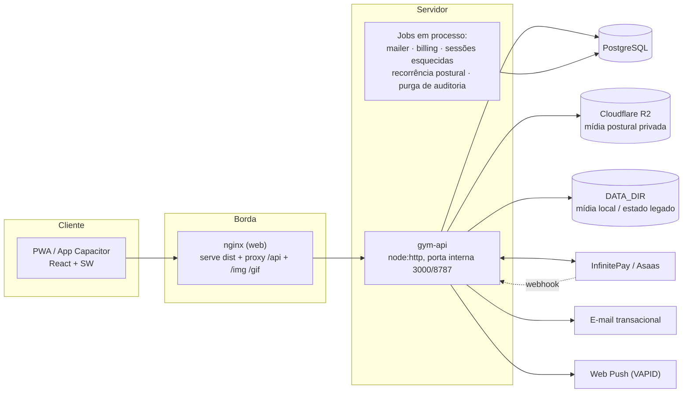

### 3.3 Pipeline de requisição da API

Toda requisição passa pela mesma esteira em `app/api/server.js`, **antes** do handler da rota (defesa em profundidade — as rotas conferem papel e escopo de novo):

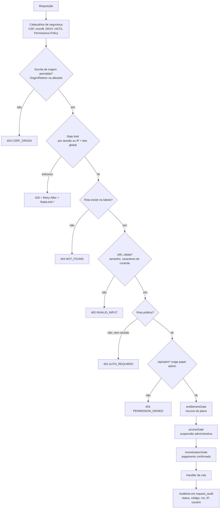

---

## 4. Modelo de dados (entidades centrais)

São 76 migrations versionadas e ~190 tabelas antes da aplicação da 077. Depois vêm as aditivas 077 (avisos da Comunidade, `community_notices`) e 078–081 (benefícios dos planos: personais por público, regras dos planos, agenda de calls, comunidade externa e lives), cada uma com `down`. As entidades que sustentam o produto atual:

| Domínio | Tabelas principais |
|---|---|
| Identidade e acesso | `tenants`, `tenant_memberships`, `users`, `roles`, `user_roles`, `user_profiles`, `user_contact`, `user_avatar`, `password_resets`, `revoked_tokens`, `server_keys`, `webauthn_credentials` |
| Vínculo profissional | `professional_profiles`, `coach_students`, `invites`, `pro_invites`, `professional_verifications`, `professional_documents` |
| Treino | `exercises`, `exercise_muscles`, `exercise_media`, `muscle_groups`, `muscles`, `equipment`, `workouts`, `workout_exercises`, `workout_templates`, `student_active_training`, `student_active_training_history` |
| Execução | `sessions`, `session_sets`, `session_events`, `session_pain_reports`, `session_time_corrections`, `session_reminders`, `guided_live_sessions`, `active_training_fixes`, `schedule_overrides` |
| Progresso | `body_weights`, `body_goals`, `usage_counters` |
| Monetização | `plans`, `plan_versions`, `subscriptions`, `subscription_events`, `billing_charges`, `billing_customers`, `payment_methods`, `billing_webhook_events`, `entitlement_grants`, `trial_grants`, `access_plans`, `user_access_plans`, `campaigns`, `promotion_codes`, `promotion_redemptions`, `coupon_changes`, `partners`, `partner_commissions`, `referral_*`, `fraud_signals`, `unlock_requests` |
| Comunidade | `posts`, `post_comments`, `post_likes`, `comment_likes`, `feed_categories`, `follows`, `social_follows`, `social_profiles`, `social_handles`, `content_reports` |
| Benefícios dos planos (078–081) | `plan_benefit_rules`, `personal_availability`, `call_bookings`, `community_links`, `community_roster`, `lives`, `live_questions`; colunas `professional_profiles.audience_sex`, `professional_profiles.zoom_url`, `user_profiles.instagram_handle` |
| #TáPago | `tapago_campaigns`, `tapago_submissions`, `tapago_events`, `tapago_preferences`, `tapago_rewards`, `tapago_reward_identities` |
| Atendimento | `threads`, `messages`, `occurrences`, `occurrence_assessments`, `change_proposals` |
| Avaliação postural | `posture_protocols`, `posture_protocol_versions`, `posture_steps`, `posture_assessments`, `posture_captures`, `posture_events`, `posture_recurrences` |
| Governança | `audit_log`, `request_audit`, `terms_versions`, `term_acceptances`, `legal_acceptances`, `data_requests`, `data_export_requests`, `notifications`, `notification_prefs`, `push_subscriptions`, `email_outbox`, `app_settings` |
| Legado | `legacy_*`, `user_app_state`, `plan_migration_049` |
| Encerrado (dados removidos pela 071) | `groups`, `challenges*`, `ranking_*`, `prizes*`, `trophy_templates`, `user_trophies` |

**Invariantes de dados**

- INV-1: todo aluno tem exatamente **um** plano de acesso e nasce vinculado ao personal principal, na mesma transação do cadastro.
- INV-2: só existe **uma** ficha ativa por aluno (`035_um_treino_ativo.sql`); publicar nova ficha arquiva a anterior sem apagá-la.
- INV-3: `social_handles` é único e imutável (`040`).
- INV-4: avaliação postural fica presa à **versão** do protocolo em que começou; versão publicada não é editável.
- INV-5: dois treinos da mesma ficha não podem ocupar o mesmo dia da semana (validado na tela **e** no servidor).
- INV-6: sessão com `origin='legado'`, anulada ou com correção manual de tempo **não entra** em métrica nenhuma (`countsInMetrics` em `api/metrics.js`).

---

## 5. Monetização e controle de acesso

### 5.1 Catálogo

| Plano | Audiência | Preço | Situação |
|---|---|---|---|
| `individual` — **Básico** | aluno | R$ 49,90/mês | **À venda** · sem `avaliacao_postural` |
| `completo` — **Completo** | aluno | R$ 499 uma vez · 90 dias (3 meses, `access_months=3`) · até 4x | **À venda** · com `avaliacao_postural`; `renews=false`. Parcelamento: configurar o máximo de 4 parcelas no painel InfinitePay (pendente; o fluxo de pagamento não foi alterado) |
| `aluno_free` | aluno | — | Inativo, nunca vendável. É o estado interno de "conta sem plano ainda" (`FREE_PLAN`); **não remover**, o cadastro depende dele |
| `pro` (Personal 15), `pro_ilimitado` (Personal Ilimitado), `profissional_free` | profissional | — | `active=false, sellable=false`. Nada apagado: versões, assinaturas e cobranças anteriores seguem consultáveis |

`GET /api/billing/pro-summary` responde **410 GONE** — não há assinatura de profissional para gerir. O personal do ambiente é admin e não paga plano.

### 5.2 Estados da assinatura

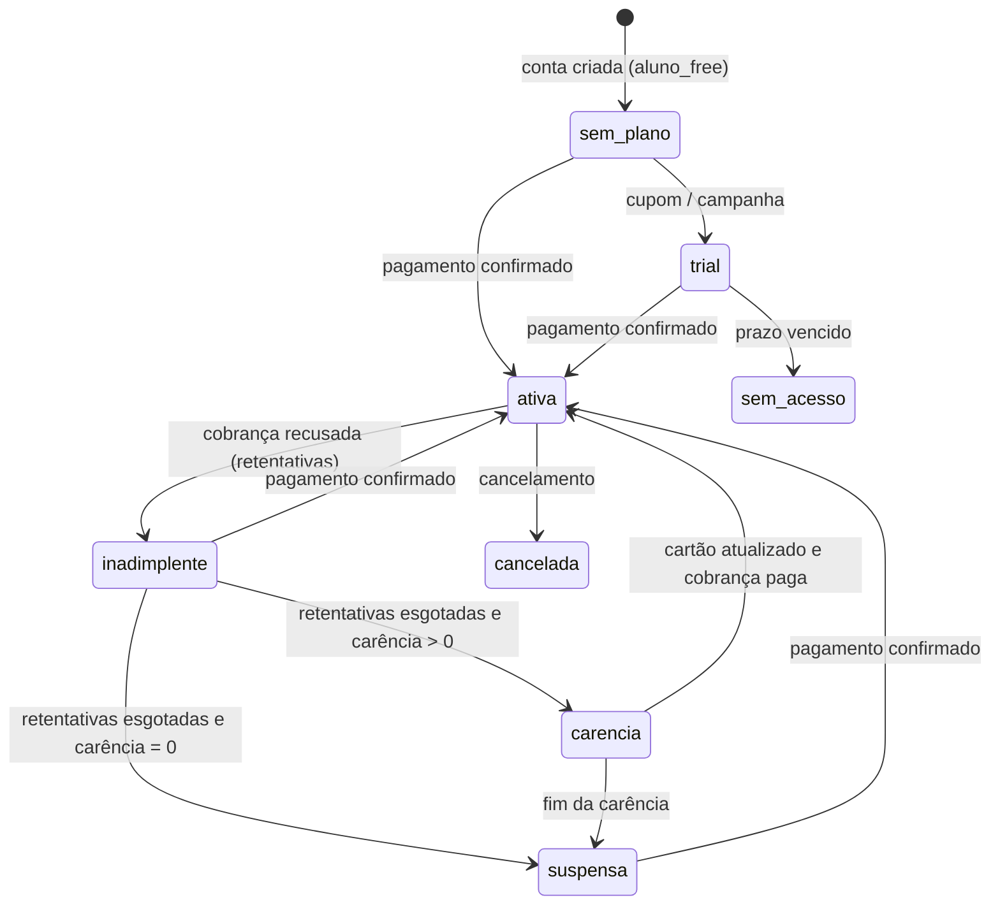

- Estados que mantêm acesso pago: `ativa`, `trial`, `inadimplente`, `carencia` (`OPEN_PAID`).
- **Suspensão financeira não trava a conta:** o usuário volta aos recursos do plano gratuito, com dados preservados.
- **Suspensão administrativa** (`users.access_suspended_at`, com responsável e motivo) é excepcional, prevalece sobre o plano e não apaga assinatura nem dados. Usar só para fraude, abuso ou violação.
- Política (carência, retentativas, dias de teste, comissão, aviso de fim de teste) vem de `app_settings`, nunca de constante no código.

### 5.3 Fontes de acesso e mensagem única

`accessSummary` consolida as fontes (`assinatura`, `teste`, `personal`, `concessao`) e devolve **um** estado com **uma** mensagem, para não haver aviso contraditório: `assinatura_ativa`, `teste_ativo`, `teste_terminando`, `teste_expirado`, `teste_expirado_personal`, `personal_ativo`, `personal_sem_direito`, `sem_acesso`.

### 5.4 Regras comerciais

- RN-M1: só assinatura paga e **confirmada** libera treinos e progresso. A comunidade entra com a assinatura; após o **Completo** expirar, a comunidade pode permanecer via grant permanente. Teste ou concessão não substituem pagamento em produção.
- RN-M2: checkout e gestão da conta ficam abertos sem pagamento — o bloqueio é do uso, não da contratação.
- RN-M3: criar a conta pelo painel **não** libera acesso; o aluno contrata a assinatura (Básico ou Completo).
- RN-M4: avaliação postural exige feature `avaliacao_postural` (plano Completo). No Básico o personal não solicita; devolutiva já publicada continua legível após o período.
- RN-M5: administradores (personal do ambiente) são isentos pelo motor central e **não** contratam plano.
- RN-M6: `client_locked` restringe programas, biblioteca, músculos, diretório e perguntas.
- RN-M7: a Biblioteca de exercícios é ferramenta de quem monta ficha — visível só para admin/personal.
- RN-M8: convite/indicação **não** substitui contratação; o banner do cadastro diz isso explicitamente.
- RN-M9: o Completo não renova automaticamente; o Básico renova pelo `price_cents` do catálogo (assinaturas antigas mantêm o valor gravado até a próxima renovação).

---

## 6. Requisitos funcionais por módulo

Legenda: **RF** requisito funcional · **RN** regra de negócio.

### 6.1 Cadastro, entrada e consentimento

- RF-1.1 Landing pública (`#/`) fala com **uma** pessoa (aluno): herói, preço, instalação, documentos legais e CTAs para criar conta. Seletor de perfil e página do profissional foram retirados; `?perfil=profissional` cai no cadastro de aluno.
- RF-1.2 Cadastro em **4 etapas**: `Acesso` → `Seus dados` → `Assinatura` → `Confirmação`. A validação acontece por etapa; erro em campo de etapa anterior devolve o usuário à menor etapa com erro.
- RF-1.3 Etapa 3 só avança com plano escolhido **e** disponível para contratação (`purchasable`, audiência aluno).
- RF-1.4 Etapa 4 exige aceite dos termos; o aceite é registrado no cadastro (`045_aceite_no_cadastro.sql`).
- RF-1.5 Login por e-mail e senha; recuperação por e-mail; troca obrigatória de senha quando marcada.
- RF-1.6 Ao concluir o cadastro, a conta abre direto em **Planos e pagamento**.
- RN-1.1 O cadastro cria **somente** aluno, vinculado ao personal principal na mesma transação. Se o principal estiver indisponível ou o vínculo falhar, o cadastro é **desfeito** e pode ser repetido depois de corrigir a configuração.
- RN-1.2 Se o personal principal estiver ausente ou inválido, o cadastro deve informar indisponibilidade e não criar aluno sem responsável. O comportamento atual precisa de validação integrada no banco de uso.
- RN-1.3 Consentimento de saúde da avaliação postural é **separado** dos termos gerais; a autorização de divulgação em redes é um **segundo** aceite, independente e opcional.

### 6.2 Ficha de treino (personal)

- RF-2.1 O personal abre **Alunos → aluno → Nova ficha de treino**, monta dias e exercícios no construtor (dados gerais → dias/exercícios → revisar/enviar) e usa **Enviar para aluno**.
- RF-2.2 Cada dia da ficha recebe um dia da semana (Domingo a Sábado) ou **Livre**.
- RF-2.3 Cada exercício aceita **um vídeo do personal** (`video_url`), em três tipos com capacidades diferentes, ditas na tela:
  - **YouTube** (recomendado, vídeo não listado): toca dentro do app, com pausa, −10 s/+10 s, barra de posição e velocidade 0,5× / 0,75× / 1×.
  - **Arquivo enviado** em *Exercícios e vídeos* (`/api/media?f=…`, até 60 MB): mesmo controle, no próprio servidor.
  - **Outro endereço https** (ex.: Instagram): abre **fora** do app, sem controle de velocidade. A tela avisa; não há player falso.
- RF-2.4 Modelos de ficha são consultados e aplicados no construtor.
- RN-2.1 Dois treinos no mesmo dia da semana são recusados na tela **e** no servidor, com os nomes dos dois no aviso.
- RN-2.2 Fichas antigas ficam com todos os dias **Livre**; nenhum registro é reescrito.
- RN-2.3 Link de canal, playlist ou busca do YouTube é recusado — não é um vídeo. A regra é a mesma em `frontend/src/lib/video.js` e `api/workout-schema.js · videoKind`.
- RN-2.4 Exercício sem vídeo mostra a imagem padrão. Vídeo removido ou privado aparece como indisponível, com a imagem como alternativa — o app não tenta recuperar sozinho.
- RN-2.5 Publicar nova ficha arquiva a anterior automaticamente; a anterior fica consultável.
- RN-2.6 Sem ficha ativa, **Treinos** informa que o aluno está aguardando o personal. Não existe ação alternativa para iniciar programa do sistema.

### 6.3 Agenda da semana (aluno)

- RF-3.1 **Treinos → Organizar semana** permite ao aluno escolher o dia de cada Treino A/B e **Salvar agenda**.
- RN-3.1 A ação altera **somente a agenda**: exercícios, séries, cargas, vídeos e orientações do personal permanecem intactos.
- RN-3.2 A API exige ficha ativa, do próprio aluno e do mesmo ambiente; a alteração entra no histórico e avisa o personal.
- RN-3.3 Mesmo com agenda definida, o aluno pode abrir qualquer Treino A/B manualmente. Sessão em andamento precisa ser concluída antes da troca.
- RN-3.4 No Início, se um dia está marcado para hoje (fuso `America/Sao_Paulo`), é esse treino que aparece; sem nada marcado, segue a sequência por sessões concluídas (`nextSessionOf` em `api/stats.js`).

### 6.4 Preparação e execução do treino

- RF-4.1 Antes de iniciar nova sessão, a tela **Defina os pesos** exige um peso numérico não negativo em kg para cada exercício de repetições. Cargas sugeridas vêm preenchidas e **precisam de confirmação**; `0 kg` indica exercício sem carga; exercícios por tempo dispensam o campo.
- RF-4.2 **Confirmar pesos e iniciar treino** solicita o início ao servidor (`startRemote`) e só então salva a sessão local. O horário do servidor prevalece quando disponível.
- RF-4.3 Durante a execução: nome do exercício antes da demonstração, mídias extras em *Como fazer*, **Iniciar série**, cronômetro de descanso ajustável, troca de exercício, pausa, relato de dor, ajuste de carga e conclusão.
- RF-4.4 **Tenho uma dúvida neste vídeo** abre a folha de dúvida com o exercício preenchido e oferece informar o trecho (ex.: "dúvida no vídeo, em 0:12"). O trecho vai no texto da mensagem — não há coluna nova no banco.
- RF-4.5 Conclusão (`/concluido`): resumo, sensação, dor e salvamento, com sincronização e histórico.
- RN-4.1 Preparar as cargas **não** cria sessão nem conta tempo de treino. Voltar abandona a preparação sem salvar.
- RN-4.2 Sessão já existente segue o fluxo de **retomada**, sem repetir a preparação.
- RN-4.3 **Dúvida não pausa** o exercício. **Dor e desconforto pausam** até a orientação do personal.
- RN-4.4 Treino esquecido: varredura a cada 5 min; lembrete a cada `SESSION_REMINDER_MIN` (padrão 60) até finalizar, corrigir ou descartar.

**Máquina de estados da sessão** (`api/session-machine.js`, espelhada em `frontend/src/lib/session-machine.js`; o servidor valida cada evento com ela e o app usa para decidir o que mostrar):

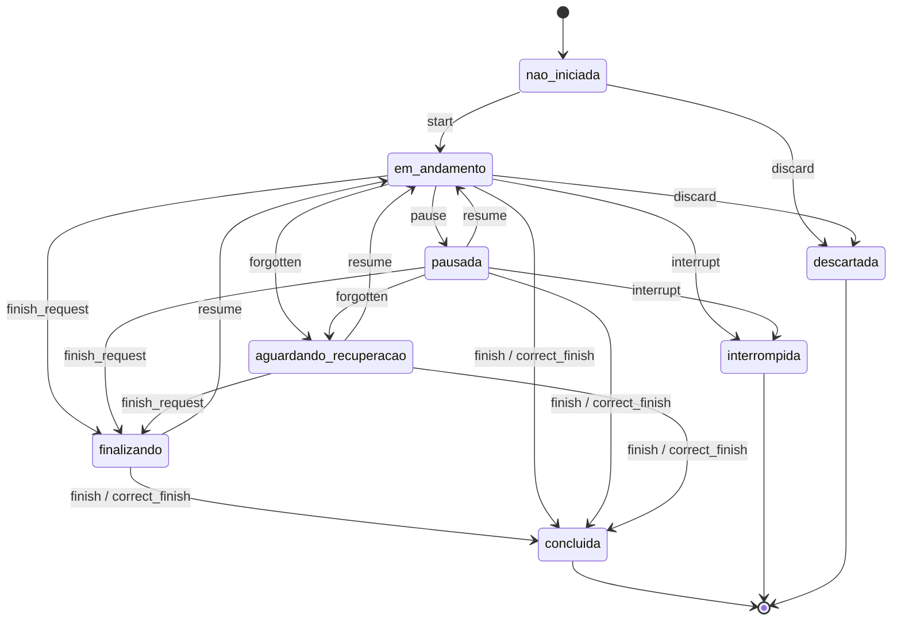

Eventos de atividade (`set_done`, `set_start`, `set_edit`, `rest_start`, `rest_adjust`, `rest_skip`, `rest_end`, `exercise_change`, `heartbeat`) **não** mudam o estado e só valem com a sessão aberta — cada um com sua lista de estados aceitos. O tempo de pausa é reconstruído a partir dos eventos (`pausedFromEvents`), não de um contador do cliente.

### 6.5 Progresso e Estatísticas

- RF-5.1 **Progresso** é o resumo da situação atual: meta semanal, treinos que faltam e totais de treino, tempo e volume da semana comparados à semana anterior.
- RF-5.2 Destaques de 30 dias aparecem **somente quando há base real**: recorde superado, evolução positiva de 1RM estimado ou grupo muscular com séries efetivas.
- RF-5.3 A tela mantém #TáPago, acesso às Estatísticas, Corpo 3D quando permitido e três treinos recentes.
- RF-5.4 **Estatísticas detalhadas**: períodos de 7, 30, 90, 180 e 365 dias ou todo o histórico; gráfico principal alterna Frequência, Volume e Tempo; força por exercício mostra melhor, primeira e última marca do recorte com variação percentual; distribuição muscular e consistência com explicação recolhida sob demanda.
- RN-5.1 Para períodos fechados, compara com o intervalo imediatamente anterior de igual tamanho. Sem valor anterior, mostra **Sem base anterior** e **não fabrica percentual**. **Tudo** não tem comparação.
- RN-5.2 As comparações usam exclusivamente sessões válidas para métricas (concluídas, não anuladas, não legadas, sem correção manual de tempo).
- RN-5.3 1RM é **estimativa** pela fórmula de Epley em séries de 1 a 12 repetições; a interface informa que não é teste de força máxima.
- RN-5.4 Aluno com escopo do personal não vê distribuição muscular nem Corpo 3D.
- RN-5.5 Erro de consulta mantém **Tentar novamente** — não há dado inventado no lugar.
- Contrato: `GET /api/guided/stats?dias=` acrescenta `comparison.previous` e `comparison.change_pct`; com `dias=0`, `comparison` é `null`.

### 6.6 Avaliação postural

Nova área em que o personal solicita, o aluno registra fotos e vídeos guiados no celular, o personal analisa etapa a etapa e publica uma devolutiva. **O sistema não produz diagnóstico postural:** coleta, organiza e devolve o texto escrito pelo profissional.

- RF-6.1 Protocolo semente com **18 etapas (15 fotografias e 3 vídeos)**, em duas versões oficiais — masculino e feminino. As etapas são **dados no banco**: o app lê quantidade e conteúdo da versão, nunca de constante no código.
- RF-6.2 O personal usa **Painel → Avaliação postural → Fila e análise → Nova solicitação**: escolhe aluno, protocolo (precisa ter versão publicada), prazo e, opcionalmente, **Repetir automaticamente** (geração mensal).
- RF-6.3 O aluno entra pelo cartão no **Início** ou no **Acompanhamento**: boas-vindas → preparação do ambiente → dados complementares → termo de privacidade → uma etapa por tela.
- RF-6.4 Em cada etapa o aluno vê instruções numeradas, cuidados e, quando o protocolo tiver mídia, foto de referência e vídeo de exemplo. Pode **tirar dúvida** (abre conversa no atendimento) ou **informar que não consegue fazer** o movimento, com justificativa.
- RF-6.5 O aluno pode sair e voltar: ao reabrir, cai na primeira etapa pendente. Arquivo escolhido e ainda não enviado fica guardado no aparelho.
- RF-6.6 Na **revisão final**, o aluno confere o total de registros, escreve observação opcional e envia.
- RF-6.7 O personal avalia cada captura como **adequada**, **solicitar recaptura** (com o motivo que o aluno vai ler) ou **não avaliável**; escreve resumo e recomendações e usa **Publicar devolutiva**, ou **Devolver para recaptura**.
- RF-6.8 A administração mantém catálogo, editor de etapas, termo do módulo, indicadores (incluindo consumo de armazenamento) e política de retenção.
- RN-6.1 **Privacidade:** as imagens são dados de saúde. Ficam em área privada, saem apenas por rota autorizada que reconfere titularidade e vínculo **a cada leitura**, e nunca aparecem no Feed, na Comunidade ou em notificações. Todo acesso do profissional à mídia é registrado.
- RN-6.2 **Imutabilidade:** publicar versão nova não altera avaliação em andamento — a avaliação fica presa à versão em que começou. Editar versão publicada é recusado; o caminho é criar versão nova, que nasce com as etapas copiadas. O protocolo oficial é somente leitura (duplicar para a organização para alterar).
- RN-6.3 **Confirmação do servidor:** nada é tratado como enviado sem o servidor confirmar. Na foto, o `sha256` é recalculado e comparado; no vídeo enviado direto ao R2, o servidor confere existência, tamanho real e tipo real do objeto antes de aceitar. Arquivo recusado continua visível no aparelho, com o motivo e a opção de tentar de novo — nada é descartado em silêncio.
- RN-6.4 Envio recusado se faltar etapa obrigatória. Publicação bloqueada enquanto houver captura sem parecer ou resumo vazio. Observações internas só aparecem ao aluno **depois** da publicação.
- RN-6.5 Recorrência mensal gera avaliações **independentes**, para comparar períodos. `POSTURAL_RECURRENCE=off` desliga geração e varredura de retenção.
- RN-6.6 Capacidade: no plano gratuito do R2 (10 GB-mês), com vídeo limitado a 25 MB, uma avaliação ocupa ~82 MB; o painel mostra o consumo e avisa a partir de 80%.
- RN-6.7 **Plano Completo:** solicitar, capturar e concluir exigem `avaliacao_postural`. Aluno no Básico vê oferta de upgrade; o personal não solicita. Devolutiva já publicada permanece legível depois que o Completo expira.

**Estados**

| Objeto | Estados |
|---|---|
| `posture_protocol_versions.status` | `rascunho` → `publicada` → `retirada` (índice único garante um só rascunho por protocolo) |
| `posture_assessments.status` | `solicitada` → `em_andamento` → `enviada` → `em_revisao` → (`recaptura_solicitada` ↻) → `publicada`; ou `cancelada` / `expirada` |
| `posture_captures.status` | `reservada` → `enviada` / `dispensada` / `substituida` / `removida` |
| `posture_captures.review_status` | `adequada` / `recapturar` / `nao_avaliavel` |

### 6.7 Comunidade e #TáPago

- RF-7.1 A área **Comunidade** separa **Publicações** e **Avisos**. Publicações mantém a alternância **Todos** / **Seguindo** e **Nova publicação** quando autorizado; os filtros "Assunto" e "Minhas publicações" permanecem fora da tela.
- RF-7.2 Comentários encadeados, curtidas em post e comentário, seguir perfis, denúncia de conteúdo e moderação.
- RF-7.3 No painel: **Publicações e moderação** (publicações e comentários, conteúdo oficial, moderação) e **Campanha #TáPago**.
- RF-7.4 **#TáPago 2.0**: editor social de card, campanha de 30 dias, recompensa e publicação **opcional e confirmada** do card na Comunidade, vinculada a uma sessão concluída e limitada a **uma por treino**.
- RN-7.1 Só o personal cria publicações; o aluno comenta e pode publicar o card #TáPago do próprio treino.
- RN-7.2 O que o personal publica sai com **o nome e a foto do perfil dele**; outro administrador continua institucional.
- RN-7.3 Engajamento é exclusivamente real — não há número inflado nem conta de vitrine.
- RN-7.4 Rotas antigas de grupo, desafio e ranking **redirecionam** para a Comunidade; as APIs deixaram de ser registradas.
- RF-7.5 Em **Avisos**, personal ativo publica card com título, mensagem, link HTTPS e banner enviado ou miniatura automática do YouTube. A publicação notifica imediatamente e aceita um lembrete futuro opcional. Ao salvar uma **Live semanal** futura como agendada, o admin publica automaticamente um card vinculado à live; o link do YouTube pode ser acrescentado depois.
- RN-7.5 O personal alcança somente alunos com vínculo ativo; o admin alcança alunos ativos do próprio ambiente. Destinatários são resolvidos no servidor, e publicação/lembrete não duplicam a notificação do mesmo aluno.
- RN-7.6 A imagem sempre aparece no card, com banner padrão quando não houver mídia. O push inclui a imagem, mas a exibição depende do sistema operacional ou navegador; a notificação interna permanece disponível.

### 6.8 Acompanhamento e atendimento

- RF-8.1 **Acompanhamento** (`/acompanhamento`) reúne responsáveis, conversas e ocorrências recolhidas, com contagem de ocorrências em aberto no Início.
- RF-8.2 Dúvidas, relatos de dor e propostas de alteração chegam em **Dúvidas e atendimentos** no painel, com prazo de resposta e filas Pendentes / Em andamento / Encerrados.
- RN-8.1 Sem personal configurado, a dúvida cai na fila administrativa.
- RN-8.2 Encerrados e propostas já decididas não oferecem nova decisão. O histórico inclui até os 200 registros mais recentes por categoria, sem apagar os demais (`GET /api/pro/dashboard?include_history=1`).
- RN-8.3 Profissional e comunidade vêm da autenticação; **IDs na URL não alteram o escopo**.

### 6.9 Painel do personal / administração

Menu de `/admin/painel` agrupado **por tarefa** (mapa em `frontend/src/views/admin/adminNav.js`). Toda tela abre com trilha (Admin › grupo › tela), título e 1–2 frases do que dá para fazer ali (componente `PageHeader`). A tela inicial é **Início**.

| Grupo | Telas (chave `?tab=`) |
|---|---|
| Início | Início (`inicio`: pendências do dia e atalhos); Números e gráficos (`dashboard`) |
| Alunos | Alunos (`usuarios`: Todas as contas, Pendências, Suspensões); Vínculos e convites (`vinculos`); Dúvidas dos alunos (`filas`) |
| Personais | Personais (`personais`: público homens/mulheres, principal, alunos, agenda); Meu perfil de personal (`perfil`) |
| Planos e cobrança | Assinaturas e cobrança (`cobranca`); Cotas dos planos (`planos-regras`) |
| Agenda de calls | Agenda de calls (`calls`) |
| Comunidade | WhatsApp e Close Friends (`comunidade-externa`); Live semanal (`lives`); Publicações e moderação (`publicacoes`); Campanha #TáPago (`tapago`) |
| Treinos e avaliações | Exercícios e vídeos (`exercicios`); Avaliações posturais (`avaliacao`); Protocolos de avaliação (`avaliacao-adm`) |
| Configurações | Configurações gerais (`config`); Dados da empresa (`empresa`); Privacidade e termos (`lgpd`); Logs e auditoria (`auditoria`) |

- RF-9.0 Chaves antigas continuam valendo (`OLD_TABS`): `assinaturas`/`monetizacao` → `cobranca`, `visao` → `dashboard`, `agenda` → `calls`, `comunidade`/`close` → `comunidade-externa`, `live` → `lives`, `cotas` → `planos-regras`, além das anteriores.

- RF-9.1 **Meu perfil de personal** edita nome de exibição, foto, apresentação, especialidades, modalidades e registro profissional (`GET /api/pro/dashboard`, `POST /api/pro/profile`).
- RF-9.2 **Novo aluno** pede **Homem/Mulher** (`perfil`), grava o sexo e vincula ao personal principal desse público; **Cadastrar personal** (tela Personais) usa `type: profissional` + `audience_sex`. Ambos via `POST /api/adm/users/create` (`type: aluno`) e devolve o link de primeiro acesso gerado por `queuePasswordLink` (24 h, uso único); a senha aleatória existe só no hash e **não** volta no JSON.
- RF-9.3 No celular, as tabelas mostram três campos por registro, com **Ver mais campos**; ordenação em seletor, busca, paginação e CSV preservados; detalhes também abrem por teclado. O nome da aba aparece uma vez (no `h1`), sem repetir na barra ☰.
- RN-9.1 Saíram do menu marketplace (Profissionais, Solicitações de vagas), Programas de catálogo, Monetização e a segunda Assinaturas. Os componentes permanecem no repositório. Abas antigas redirecionam: `programas` → Exercícios; `assinaturas` / `monetizacao` → Assinaturas dos alunos; `profissionais` / `solicitacoes` → Alunos.
- RN-9.2 Ocultar recurso no menu é **apresentação**: autorização, vínculo, limites e bloqueios continuam sendo conferidos na API.
- RN-9.3 O registro profissional fica guardado como **informado** — o app não consulta o conselho nem exibe selo de conferido.
- RN-9.6 A Visão geral mostra só atenção útil (contas pendentes/suspensas e atendimentos atrasados) e indicadores de contas, cadastros, treinos, vínculos e assinaturas. Cards de vagas, verificação profissional e o gráfico de ocupação por profissional não aparecem.
- Contrato de indicadores: `GET /api/adm/management?period=7|30|90` (padrão 30), só admin autenticado, restrito à comunidade da sessão. Período inválido → 400; anônimo → 401; aluno/profissional → 403. Resposta: `period`, `timezone`, `generated_at`, `start_date`, `end_date`, `previous_start`, `indicators`, `comparison`, `series`, `subscriptions`, `occupancy`, `capacity`, `pending`.
- RN-9.4 Percentual = (atual − anterior) / anterior × 100, uma casa decimal; **base anterior zero resulta em `null`**, exibido como indisponível. Números apurados por consulta, não por snapshot. O dia atual pode estar incompleto.
- RN-9.5 Quando falta esquema no banco, a API de indicadores responde **503 com aviso de atualização pendente**, em vez de apresentar métrica incompleta.

### 6.10 Notificações, privacidade e legal

- RF-10.1 **Avisos** (`/avisos`): Não lidas / Todas, marcar todas como lidas. Preferências por tipo em `notification_prefs`; push por VAPID e notificação local no app nativo.
- RF-10.2 Eventos de cobrança também saem por push e e-mail (`setBillingPush`).
- RF-10.5 Avisos da Comunidade usam a lista interna e o Web Push existentes; tocar leva ao card em `/comunidade?tab=avisos&aviso=<id>`, e o botão do card abre o destino HTTPS.
- RF-10.3 Documentos legais versionados (`/legal/termos`, `/privacidade`, `/assinatura`, `/comunidade`, `/profissional`) com aceite registrado e identificação da empresa (`GET /api/legal/company`).
- RF-10.4 LGPD: pedido de exportação e de exclusão pelo titular (`POST /api/me/export-request`, `/api/me/delete-request`); a administração decide em **Privacidade e pedidos**; exclusão é **anonimização** com confirmação digitada ("EXCLUIR").
- RN-10.1 Retenção da auditoria configurável (`app_settings.auditoria_retencao_dias`, padrão `AUDIT_RETENTION_DAYS` ou 180), com purga em job.
- RN-10.2 Logs não gravam corpo da requisição nem `detail` do Postgres (podem conter e-mail e valores).

---

### 6.11 Benefícios dos planos: cotas, calls, comunidade externa e live

Regras por plano em `plan_benefit_rules` (migração 079; editáveis em Admin › Cotas dos planos). Ids centralizados em `api/plan-rules.js` e `frontend/src/lib/plans.js` (`STUDENT_PLANS = { basico: 'individual', premium: 'completo' }`).

| Regra | Básico (`individual`) | Completo (`completo`) |
|---|---|---|
| Ficha nova | 1 por mês (ciclo pago) | 1 a cada 15 dias |
| Call de 15 min (Zoom) | 1 por mês | 1 a cada 15 dias |
| Close Friends | 7 dias a cada mês | os 90 dias |
| Grupos WhatsApp | geral, avisos | geral, avisos, exclusivo |
| Live | pergunta | pergunta com prioridade |
| Sorteios | — | planejado (futuro; migração 071 mantida) |

- RN-11.1 **Fichas:** só contam ficha nova publicada/criada (`pro_plan_history` `publicado`/`criado`, ou `criado_admin` já ativo). Editar não conta. Passar da cota **só avisa** o personal (`quota_warning`, código `FICHA_QUOTA_EXCEEDED`); a ficha é entregue.
- RN-11.2 **Calls:** o personal (ou o admin por ele) cadastra faixas semanais e um link fixo do Zoom (migração 080). O aluno reserva blocos de 15 min com antecedência mínima de **12 h** e cancela até **6 h** antes (`calls_antecedencia_horas`, `calls_cancelamento_horas` em Configurações). Cota por janela; call não usada **não acumula**; o mesmo horário não aceita duas reservas (índice único + lock). Acima da cota o **aluno é bloqueado** (`CALL_QUOTA_EXCEEDED`); personal/admin marcam manualmente com aviso. A confirmação é um botão `wa.me` com data/hora de Brasília e o link do Zoom. Remarcar = cancelar e reservar de novo.
- RN-11.3 **Fim do plano:** o aluno sai do grupo exclusivo e do Close Friends e entra na lista "Remover" do admin; grupos geral/avisos continuam por padrão (`comunidade_manter_geral`, `comunidade_manter_avisos`). O admin marca "Já adicionei"/"Já removi" (migração 080, `community_roster`); listas exportam CSV.
- RN-11.4 **Live semanal:** admin marca título, data e link opcional do YouTube; aluno com plano manda até 3 perguntas por live; Completo aparece primeiro na fila. A live agendada cria imediatamente um único card em Avisos e uma notificação para os alunos ativos, com segundo lembrete no horário. Edição sincroniza o mesmo card; cancelamento ou encerramento encerra o aviso e o lembrete pendente.
- RN-11.5 Assinaturas antigas: as regras valem pelo `plan_id`, então quem já comprou recebe os benefícios novos sem mudar preço ou duração.
- Telas: aluno em **Perfil › Meus benefícios** (`/beneficios`); personal em **/pro?tab=agenda**; admin em Início, Personais, Cotas dos planos, Agenda de calls, WhatsApp e Close Friends, Live semanal.
- **Futuro:** plano de dieta; sorteios; remarcação em um passo; integração com a API do Zoom/Instagram (hoje links e listas são manuais).

## 7. App Flow

### 7.1 Mapa de navegação por papel

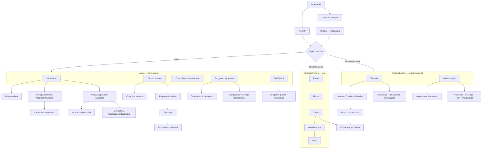

Rotas encerradas (`/grupo/:id`, `/desafio/:id`, `/desafios/criar`, `/ranking`) e rotas de catálogo (`/programas`, `/programa/:id`, `/meu-programa`, `/recomendados`, `/onboarding`) **redirecionam** para Comunidade e Treinos — app antigo em cache não abre tela vazia nem cria programa novo.

### 7.2 Aluno — do zero ao primeiro treino

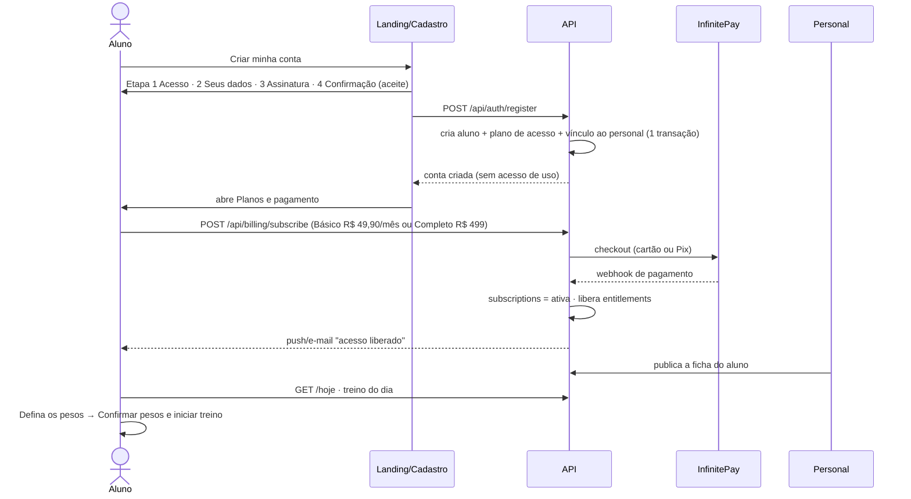

Sem ficha publicada, **Treinos** informa que o aluno está aguardando o personal — e nada mais.

### 7.3 Aluno — execução do treino

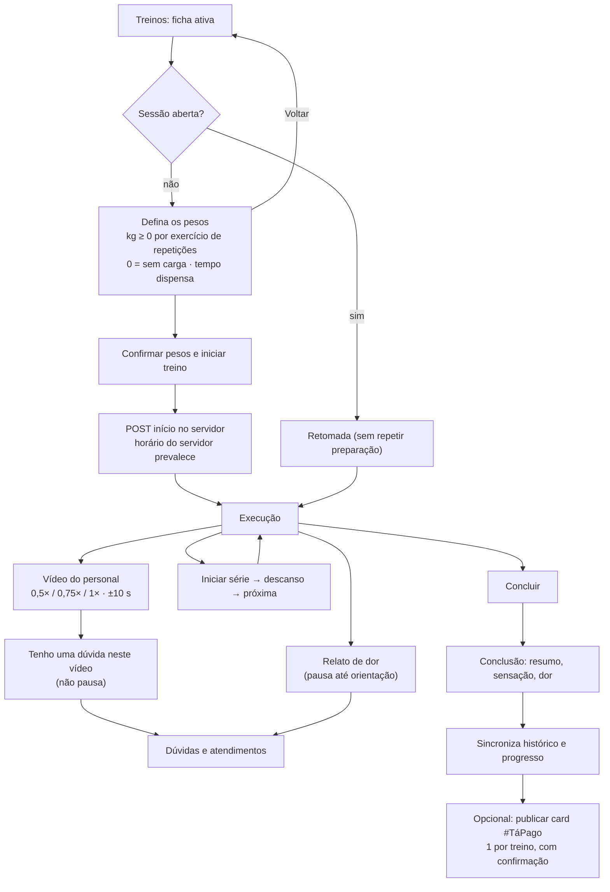

### 7.4 Avaliação postural — ciclo completo

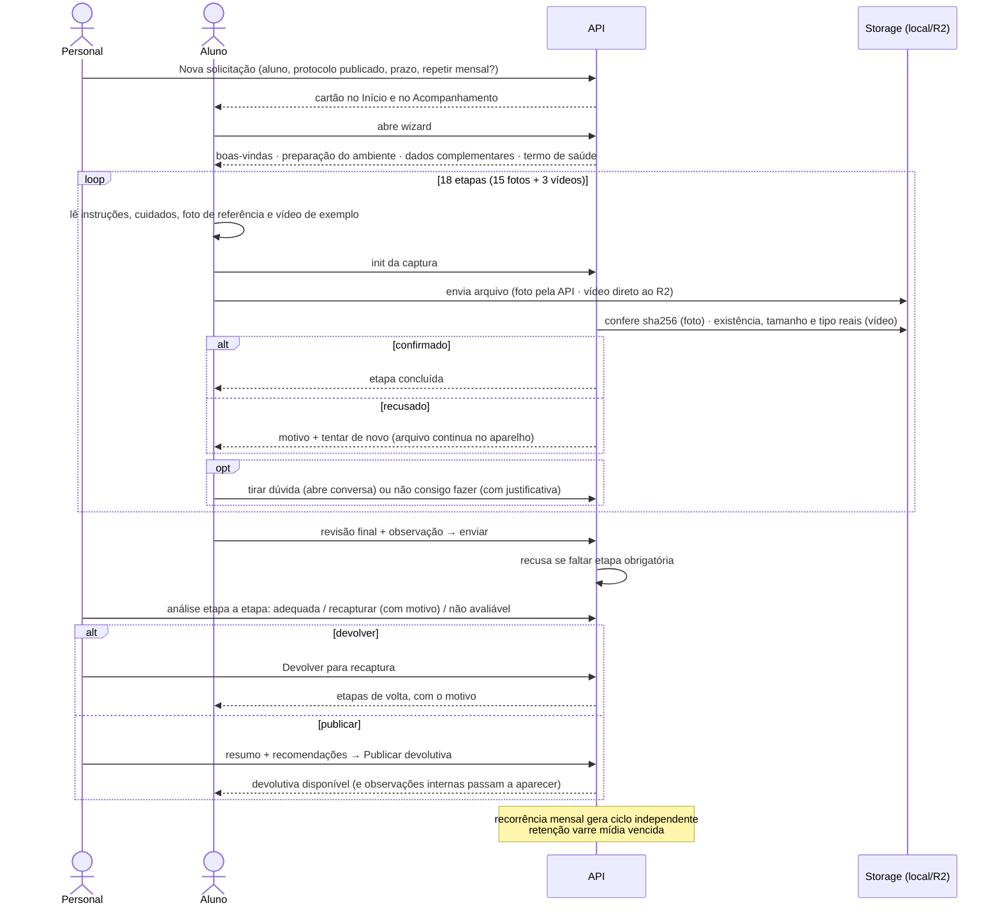

### 7.5 Personal — publicar uma ficha

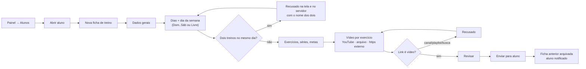

---

## 8. Fluxo do sistema

### 8.1 Cobrança e liberação de acesso

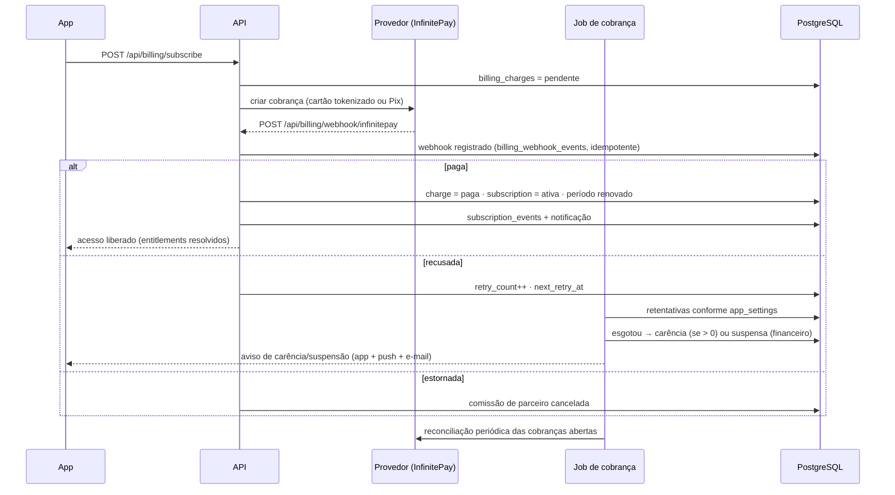

- Webhook é servidor-a-servidor: aceito sem `Origin` (a regra CSRF abre exceção explícita para `POST /api/billing/webhook/*`), com teto de 600 req/min.
- Nenhum valor comercial fica no código: preço vem do plano; carência, retentativas, dias de teste e comissão vêm de `app_settings`.

### 8.2 Resolução de entitlements (quem pode o quê)

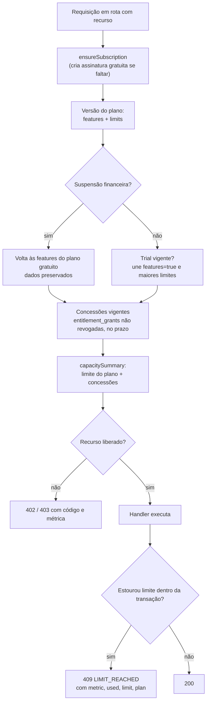

### 8.3 Mídia privada da avaliação postural

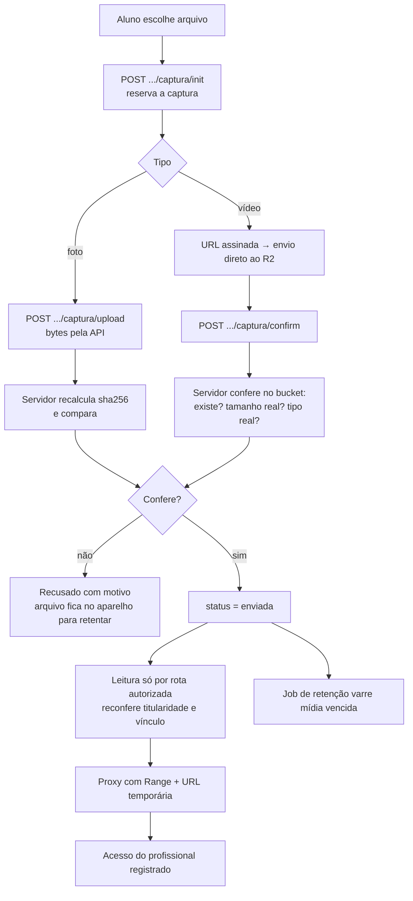

A mídia postural **nunca** aparece no Feed, na Comunidade ou em notificações.

### 8.4 Jobs em processo

| Job | Periodicidade | O que faz | Desligar |
|---|---|---|---|
| `startMailer` | contínuo | Drena `email_outbox`; só envia com SMTP configurado | sem SMTP |
| `forgottenSweep` | 5 min | Sessão esquecida → `aguardando_recuperacao` + lembrete a cada `SESSION_REMINDER_MIN` | `SESSION_SWEEP=off` |
| `startBillingJob` | tick | Renovação, retentativa, carência, suspensão, reconciliação | `BILLING_TICK=off` |
| `startNoticeReminderJob` | 1 min | Envia uma vez os lembretes vencidos dos avisos da Comunidade | `NOTICE_REMINDER_SWEEP=off` |
| `startPosturalRecurrence` | diário | Recorrência mensal idempotente + retenção de mídia | `POSTURAL_RECURRENCE=off` |
| `startAuditPurge` | diário | Retenção de `request_audit` (padrão 180 dias) | `AUDIT_RETENTION_DAYS` |

### 8.5 Offline e atualização do app

- O service worker tem o nome do cache selado com o `BUILD_ID` do build: bytes diferentes a cada publicação, então o PWA instalado detecta a versão nova e se atualiza sozinho. `dist/version.json` carrega o mesmo identificador.
- Sessão de treino tem continuidade offline: `startRemote` preserva a autorização existente; a fila local (`lib/outbox.js`) sincroniza depois.
- O build falha se o bundle contiver `U+FFFD` — arquivo salvo fora de UTF-8 não chega à tela com caracteres corrompidos.

---

## 9. Requisitos não funcionais

### 9.1 Segurança

| Controle | Implementação |
|---|---|
| Cabeçalhos | CSP `default-src 'none'` na API, `X-Frame-Options: DENY`, `nosniff`, `Referrer-Policy`, CORP/COOP `same-origin`, `Permissions-Policy` sem câmera/microfone/geo/pagamento, HSTS em HTTPS |
| CSRF | Escrita de outra origem recusada (`403 CSRF_ORIGIN`). Sem `Origin`/`Referer`, só passa webhook de pagamento ou cliente com `Bearer` (não é navegador) |
| Rate limit | Janela fixa por rota, por **sessão** quando autenticado (academia com Wi-Fi compartilhado não trava todos) e por IP em login/cadastro/recuperação; teto **global** adicional em rota pública que chama serviço externo (`/api/cep`); cabeçalhos `RateLimit-*` e `Retry-After` |
| Autenticação | JWT em cookie `HttpOnly SameSite=Lax` ou `Bearer`; `revoked_tokens`; senha `bcryptjs`; troca obrigatória quando marcada |
| Autorização | Middleware central (papel `admin` para `/api/adm/*`, entitlements, acesso, monetização) **e** reconferência na rota. Escopo vem da autenticação — ID na URL não muda escopo |
| Multi-tenant | `tenant_id` nas tabelas e `tenantScope` nas consultas |
| Validação de URL | Caminho ≤ 512, query ≤ 4096, recusa caracteres de controle |
| Auditoria | `request_audit` por requisição (método, rota, status, código, ms, IP real, usuário) e `audit_log` por ação de negócio |
| IP real | `cf-connecting-ip` só vale vindo do gateway local; `X-Forwarded-For` ignorado |
| Erros | Mensagem genérica ao cliente (`SERVER_ERROR`); log sem corpo da requisição e sem `detail` do Postgres |
| Segredos | Só no backend, via `.env`; nunca no bundle. Documento proíbe credencial na documentação |

### 9.2 Privacidade

- Consentimento de saúde separado dos termos gerais; divulgação em redes é aceite independente e opcional.
- Mídia de saúde em área privada, com reconferência de titularidade a cada leitura e registro de todo acesso profissional.
- Contato e endereço do aluno são privados por padrão; o aluno escolhe o que mostrar no perfil.
- Exportação e exclusão (anonimização) pelo titular, com decisão administrativa registrada.

### 9.3 Interface, acessibilidade e idioma

- Mobile-first, 320/360/390/768/1280/1440 px, temas claro e escuro, tokens grafite/limão.
- Abas e filtros curtos se acomodam em linhas, com rótulo completo e seleção destacada; no celular o menu administrativo abre como lista vertical.
- `role="tablist"`/`aria-selected` nas abas, `aria-required` em campos obrigatórios, `role="alert"` em erro, detalhes abríveis por teclado; cenários Playwright + axe-core.
- Linguagem profissional e direta: sem gíria, sem "chute", sem promessa de resultado. Falha sempre oferece **Tentar novamente**.
- 11 idiomas, com português como padrão.

### 9.4 Confiabilidade e honestidade do dado

- Indicador sem base anterior mostra **Sem base anterior**; percentual com base zero é `null`, exibido como indisponível.
- Nenhum número é snapshot inventado: tudo é apurado por consulta.
- Falta de esquema no banco → **503 com aviso de atualização pendente**, nunca métrica incompleta.
- Engajamento da Comunidade é exclusivamente real.
- 1RM é declarado como estimativa; a avaliação postural é declarada como não-diagnóstica.

---

## 10. Ambientes, implantação e rollback

### 10.1 Portas e origens

| Ambiente | App | API |
|---|---|---|
| Desenvolvimento | `http://localhost:5551` (loopback IPv4 `127.0.0.1`) | `http://localhost:8787` |
| Produção | nginx serve `dist` e faz proxy de `/api`, `/img`, `/gif` | porta interna 3000; `HOST=127.0.0.1` recomendado (só o gateway/túnel acessa) |

`ORIGIN` na API precisa casar com a porta do app, para login, cookies e validação de origem funcionarem.

### 10.2 Variáveis relevantes

`ORIGIN`, `CSRF_ALLOWED_ORIGINS`, `HOST`, `PORT`, `DATA_DIR`, `DB_*`, `SESSION_DAYS`, `RATE_LIMIT`, `SESSION_SWEEP`, `SESSION_REMINDER_MIN`, `BILLING_TICK`, `NOTICE_REMINDER_SWEEP`, `POSTURAL_RECURRENCE`, `AUDIT_RETENTION_DAYS`, `STORAGE_DRIVER` (`local` padrão), `R2_ACCOUNT_ID`, `R2_BUCKET`, `R2_ACCESS_KEY_ID`, `R2_SECRET_ACCESS_KEY`, VAPID, SMTP e chaves do provedor de pagamento. A lista completa, com os valores de exemplo, fica em `app/api/.env.example` e `app/.env.example`.

Para o R2: bucket **privado**, sem domínio personalizado e sem URL pública de desenvolvimento.

### 10.3 Migrations e rollback

- `npm run migrate` (`api/db/migrate.js`) é idempotente — rodar duas vezes não duplica registro.
- Toda migration tem `down` correspondente em `api/db/down/`; Avisos usa `077_avisos_comunidade.sql` e `077_down.sql`. Benefícios dos planos usam `078_personais_publico.sql`, `079_beneficios_planos.sql`, `080_agenda_calls.sql` e `081_comunidade_externa_lives.sql` (downs `078_down.sql` a `081_down.sql`).
- `071_remover_grupos_desafios_ranking.sql` é **destrutiva**: apaga dados de grupos/desafios/ranking e suas concessões. **Já aplicada no banco local**, após backup validado e com a prévia da rotina de mídias acusando zero arquivos. Também foi aplicada na VPS sobre um banco recém-criado, sem dados anteriores. Em qualquer base já utilizada, aplicar só com backup confirmado e rodando antes `api/scripts/remover-midias-desafios.mjs`, que lista em modo seguro e só remove arquivos com confirmação explícita.
- Rollback do módulo postural: `072_down.sql` devolve `threads` e `legal_acceptances` aos CHECK anteriores e remove as sete tabelas. `pg_dump` validado antes, como em qualquer migration.
- `068_down.sql` religa Individual a R$ 12,90 e os planos de personal; `069_down.sql` remove `personal_user_id`. Campanhas reescritas pela 068 **não** voltam ao plano antigo automaticamente — conferir cupons depois de uma volta.

### 10.4 Scripts operacionais

| Script | Para quê |
|---|---|
| `api/scripts/create-admin.mjs` | Criar o primeiro administrador (eleito depois como personal principal) |
| `api/scripts/verificar-plano-unico.mjs` | 19 conferências somente leitura do catálogo e do vínculo |
| `api/test/plano-unico.integration.mjs` | 13 conferências de integração do vínculo e das isenções |
| `api/scripts/transicao-personais-antigos.mjs` | Prévia e, com `--apply`, transição de contas profissionais antigas |
| `api/scripts/definir-precos.mjs`, `virada-monetizacao.mjs` | Preços e virada comercial |
| `api/scripts/diagnostico-asaas.mjs`, `r2-smoke.mjs` | Diagnóstico de provedor e smoke do bucket |
| `api/scripts/zerar-dados.mjs`, `remover-usuarios.mjs` | Limpeza em ambiente de teste |
| `app/scripts/dev-start.ps1`, `dev-stop.ps1`, `deploy-pack.ps1` | Subir/parar o ambiente local e empacotar deploy |

---

## 11. Estado de validação e pendências conhecidas

Os itens abaixo são evidências históricas registradas nesta cópia, não nova homologação executada nesta revisão documental. A implementação e o banco de uso devem ser conferidos antes de afirmar que qualquer jornada está pronta para lançamento.

**Aprovado localmente (21/10/2026)**

- Avaliação postural: 95 testes automatizados do módulo contra banco de teste recriado do zero (10 de storage, 12 de conferência de mídia, 10 do job de recorrência/retenção, 23 de integração do aluno, 21 do profissional, 19 da administração).
- Frontend: 322–356 testes unitários (conforme o recorte da entrega) e build de produção.
- Plano único: migrations 068/069 em banco isolado `orny_plano_unico`, migrador rodado duas vezes sem duplicar; 19 conferências de catálogo/personal e 13 de integração aprovadas, incluindo o teste negativo que confirma que a isenção do personal **não vazou** para outro profissional.
- Ficha: 10 testes da API do formato (dia da semana, agenda editável pelo aluno sem mudar exercícios, conflito de dias, tipos de vídeo, vídeo opcional).
- Progresso/Estatísticas: 8 cenários Playwright em 320/390/768/1280 px, temas claro e escuro.
- Painel de gestão: 35 conferências de integração em base isolada e 2 cenários de navegador.

**Não homologado**

- Avaliação postural não foi aberta em navegador nem exercitada em aparelho real; não há cenários Playwright próprios do módulo; o driver R2 não foi exercitado contra o bucket real (falta token — smoke manual em `api/scripts/r2-smoke.mjs`).
- Comparação visual lado a lado entre períodos da avaliação postural **não** implementada (o histórico lista ciclos e a análise mostra a mesma etapa do ciclo anterior).
- Cenários de navegador do cadastro em 4 etapas, do player de vídeo e da dúvida no exercício.
- Publicação de ficha pelo personal ponta a ponta pela interface.
- Primeira cobrança real de Básico (R$ 49,90) ou Completo (R$ 499) ponta a ponta na InfinitePay (prova operacional externa, não coberta por simulação).
- Instalação interna da 2.0.1 na VPS concluída no commit `4dd90a1`, em banco novo e isolado; a conferência detalhada abaixo ainda vale para o banco local e precisa ser repetida na VPS antes de uso real. Publicação pública e cobrança real seguem pendentes.

**Banco local — conferência e ajuste de 21/10/2026**

Conferência somente leitura no banco `avagym` (`localhost`), mais `npm run verificar:plano-unico`:

- As **72 migrations** do repositório constam em `schema_migrations`; **nenhuma pendente**. A 071 (destrutiva) **já foi aplicada**: as tabelas de Grupos, Desafios, Ranking, prêmios e troféus não existem mais, e a prévia da rotina de mídias havia encontrado zero arquivos.
- `sessions.origin` e `sessions.time_corrected_at` **existem** — a lacuna de esquema que bloqueava o painel de gestão está resolvida.
- Catálogo conciliado: `individual` (Básico) a 4990 centavos e `completo` a 49900, ambos ativos e vendáveis; `pro`, `pro_ilimitado` e `profissional_free` inativos e fora de venda; `aluno_free` preservado e com versão de plano.
- `personal_user_id` definido e `personal_unico` ativo. `monetizacao_ativa=false` neste banco.
- Duas linhas órfãs em `schema_migrations` (`034_resend_transactional.sql` e `068_dados_legais_ornygym.sql`) correspondem a arquivos renumerados no repositório. São inofensivas — o conteúdo atual consta aplicado sob os nomes novos —, mas não devem ser interpretadas como migrations existentes.
- O verificador fechou primeiro em **17 de 19**, com duas falhas de configuração de dados (não de código): o personal principal sem papel `admin`, o que anula a isenção de vaga e de limite (RN-P3 exige `personal_user_id` **e** papel `admin`), e um aluno sem plano de acesso, pré-condição do vínculo.
- **Ambas corrigidas no mesmo dia**, em transação única, após `pg_dump` validado (`backups/avagym_20261021_205055_antes-ajuste-verificador.dump`, 149 tabelas com dados): papel `admin` concedido ao principal e plano `personal_unico` atribuído ao aluno, pela mesma regra da migration 069. As duas gravações estão em `audit_log` (`personal_principal.papel_admin` e `aluno.plano_acesso_atribuido`). **Nova execução do verificador: 19 de 19, nenhuma falha.**
- Efeito colateral aceito: o personal principal passou a acumular `admin` + `profissional`, ou seja, tem acesso administrativo pleno ao painel. É o modelo do produto (o personal **é** o administrador do ambiente) e condição da isenção, mas desfaz a separação que a rotina `ativar-personal-principal-local.mjs` havia criado entre a conta administrativa e a conta de atendimento.
- Na suíte isolada da API, uma asserção antiga e independente de recursos de boas-vindas continua falhando. No arquivo E2E completo, 4 cenários falham em fluxos de acesso/compartilhamento alheios ao recorte das últimas entregas.

---

### Critérios de aceite do produto

1. **Cadastro e cobrança:** um aluno novo conclui as quatro etapas, fica vinculado a um personal e chega ao pagamento; enquanto a cobrança estiver pendente, as áreas pagas permanecem bloqueadas; a confirmação oficial libera o acesso uma única vez.
2. **Ficha individual:** o personal responsável publica a ficha com dias, exercícios e vídeo; só o aluno vinculado a vê; uma nova ficha arquiva a anterior sem perder sessões e cargas.
3. **Treino A/B:** o aluno organiza a semana sem editar a prescrição, escolhe outro treino antes de iniciar quando desejar e não consegue ter dois treinos no mesmo dia marcado.
4. **Execução:** confirmar pesos inicia a sessão no servidor; séries, descanso, dúvida, dor, retomada e conclusão preservam o histórico. Dúvida não pausa; dor segue a orientação do personal.
5. **Progresso:** uma sessão válida concluída altera os indicadores. Período sem base anterior mostra a ausência de comparação, sem percentual inventado.
6. **Avaliação postural:** apenas o aluno e o profissional autorizado acessam as mídias; envio só conclui após confirmação; recaptura informa motivo; devolutiva é publicada pelo profissional, sem diagnóstico automático.
7. **Compatibilidade e operação:** fluxos principais funcionam em 320, 390, 768 e 1280 px, com navegação por teclado onde aplicável; banco e integrações do ambiente alvo são validados antes da publicação. A marca exibida e os documentos legais exigem revisão própria antes de apresentar o produto ao público como Projeto Vitor.

## 12. Riscos

| Risco | Impacto | Mitigação existente |
|---|---|---|
| Histórico de migrations incompleto em outro ambiente | Painel e métricas sem esquema | API responde 503 com aviso em vez de métrica incompleta; banco local foi conferido em detalhe e o banco novo da VPS recebeu as 72 migrations, mas ainda precisa da verificação funcional completa |
| Migration 071 destrutiva | Perda irreversível de dados de grupos/desafios | Exige backup confirmado em base com dados; foi aplicada no banco local com backup e na VPS sobre banco novo, sem dados anteriores |
| Dependência de um único personal principal | Ambiente sem admin não vincula alunos; sem papel `admin` o principal perde a isenção de limite | Cadastro continua funcionando; `verificar:plano-unico` acusa a falta — foi assim que as duas falhas do banco local apareceram e foram corrigidas em 21/10/2026 |
| Cobrança real nunca exercitada ponta a ponta | Primeira assinatura pode falhar em produção | Provedor `simulado` nos testes, reconciliação e diagnóstico no job; prova operacional pendente |
| Mídia de saúde em nuvem | Exposição de dado sensível | Bucket privado, rota autorizada com reconferência, registro de acesso, retenção automática, 25 MB por vídeo |
| Teto do plano gratuito do R2 (10 GB-mês) | Avaliações bloqueadas por armazenamento | Indicador de consumo com aviso a partir de 80% |
| App antigo em cache chamando rota encerrada | Tela vazia ou criação indevida | Rotas encerradas redirecionam; APIs recusam com motivo; `intent` do cadastro é ignorado |
| Vídeo de terceiro removido ou privado | Exercício sem demonstração | Estado "indisponível" com a imagem como alternativa, sem recuperação silenciosa |

---

## 13. Glossário

| Termo | Significado |
|---|---|
| **Personal** | O administrador do ambiente, responsável por atender os alunos |
| **Personal interno** | Profissional da equipe, criado pelo Admin, que recebe alunos por transferência e é isento de assinatura profissional |
| **Ficha de treino** | O plano individual criado pelo personal; única fonte de treino do aluno (uma ativa por aluno) |
| **#TáPago** | Card social do treino concluído, publicável na Comunidade com confirmação, um por treino |
| **Devolutiva** | Texto de resumo e recomendações que o profissional publica ao fim da avaliação postural |
| **Entitlement** | Recurso ou limite efetivo = versão do plano + trial + concessões vigentes |
| **Concessão** (`entitlement_grant`) | Liberação temporária de recurso ou vaga, com motivo e validade |
| **Carência** | Período em que o acesso continua após cobranças recusadas, antes da suspensão |
| **Sessão válida para métrica** | Concluída, não anulada, não legada e sem correção manual de tempo |
| **Tenant** | Ambiente/comunidade isolada; todo dado de negócio carrega `tenant_id` |

---

## 14. Referências no repositório

| Assunto | Onde |
|---|---|
| Fonte única de comportamento | `app/DOCUMENTACAO-SISTEMA.md` |
| Guia diário do personal | `docs/como-usar-o-sistema.md` |
| Esteira de requisição, rotas, rate limit, CSRF | `app/api/server.js` |
| Autenticação, papéis, escopo | `app/api/auth.js`, `app/api/access.js` |
| Planos, entitlements, capacidade | `app/api/entitlements.js`, `app/api/billing/core.js`, `app/api/billing/routes.js` |
| Provedores de pagamento | `app/api/billing/providers/{infinitepay,asaas,simulado}.js` |
| Ficha e validação do formato | `app/api/workout-schema.js`, `app/frontend/src/views/builder/WorkoutBuilder.jsx` |
| Sessão de treino | `app/api/session-machine.js`, `app/api/sessions-v4.js`, `app/frontend/src/views/guided/Train.jsx` |
| Métricas e estatísticas | `app/api/metrics.js`, `app/api/stats.js`, `app/api/management.js` |
| Avaliação postural | `app/api/postural{,-pro,-adm,-media,-job}.js`, `app/api/db/postural-protocol.js`, `app/frontend/src/views/postural/` |
| Comunidade e #TáPago | `app/api/community*.js`, `app/api/social.js`, `app/api/tapago.js` |
| Painel do personal | `app/frontend/src/views/admin/AdminApp.jsx` |
| Navegação e visibilidade | `app/frontend/src/lib/navigation.js`, `app/frontend/src/components/NavigationAccess.jsx` |
| Migrations e voltas | `app/api/db/migrations/`, `app/api/db/down/` |
| Execução local | `app/docs/EXECUCAO-LOCAL.md` |
| Implantação | `app/docker-compose.yml`, `app/web/gateway.mjs`; publicação requer validação própria |

